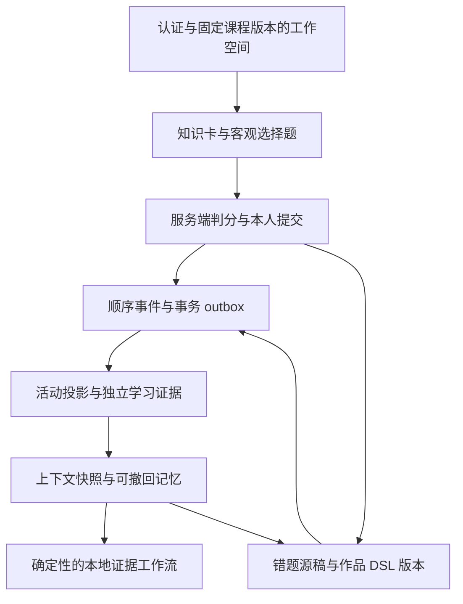

# 泛型工坊 TypeForge · Agent 学习工作空间

以 **Java 泛型与类型安全** 为课程主线，把知识阅读、客观练习、学习证据、工作空间上下文与可编辑作品连成一条可追溯的数据链。完整产品的目标是让专家集群辅助学生制作文档、PPT、图解、音视频与交互错题集；当前已实现的能力和后续目标分别说明。

**当前交付为 v0.3 持久化学习运行时。** 后端已接入 Spring JDBC、Flyway 和事务，提供会话认证、已发布课程读取、本地 BM25 检索、客观选择题判分、工作空间与目标、顺序事件与 outbox 投影、上下文快照与记忆撤回、作品 DSL 版本、错题源稿及受控的本地证据工作流。任务运行时包含持久 DAG、租约、epoch、预算预留与结果准入。模块状态以 [模块清单](contracts/modules.json) 为准，逐操作状态以 [OpenAPI](contracts/openapi.json) 的 `x-status` 为准；具体操作数量和验证结果见 [v0.3 验收记录](evidence/runtime-review.md)。

**前端、LLM 规划与导师、用户代码编译沙箱、媒体生成、二进制导出、正式编辑审核发布仍不可用。** 当前本地证据工作流只执行确定性的知识检索与证据整理，不调用模型，不冒充专家自治或生成教学答案。`businessReady=false` 保留这一整体边界；运行时能力可在登录后查询 `/api/v1/capabilities`。

## 阅读入口

1. [整体框架与评分映射](docs/00-blueprint.md)：范围、模块、两人目标与证据要求。
2. [架构深化决策](docs/13-architecture-upgrade.md)与[本轮研究决策](docs/14-research-decisions.md)：状态、数据、权限、运行时与外部项目借鉴。
3. [动态专家集群](docs/10-agent-cluster.md)与[学习作品](docs/11-learning-artifacts.md)：完整目标、运行控制、生产与审核边界。
4. [模块设计](docs/02-modules.md)、[架构数据流](docs/01-architecture.md)与[API 约定](docs/04-api.md)：当前实现和后续接口如何衔接。
5. [前端规范](docs/07-frontend.md)与[跨模块状态协议](docs/15-frontend-state-network.md)：页面、状态、重放、草稿冲突与可访问性。当前没有正式前端；209 条参考台账不等于浏览器实测。
6. [两人开发计划](docs/09-team-plan.md)、[课程交付验收](docs/16-course-delivery.md)与[验收矩阵](evidence/course-acceptance-matrix.csv)。
7. [v0.3 验收记录](evidence/runtime-review.md)；[v0.2 基线检查](evidence/baseline-review.md)仅保留为历史证据。

## 已实现的数据主链



读取活动、重复练习和作品保存不会被当作独立掌握。来自不同题目家族的首次客观作答才贡献独立样本；投影滞后有可见状态。作品输入固定资源 ID、revision 和 hash，撤回或修改可使依赖过期；旧 Agent 执行结果不能绕过版本与租约检查覆盖学生稿件。

Java 泛型用于 `AgentTool<I,O>`、作品端口和类型安全教学案例。跨进程输入仍需 JSON Schema、权限、数据库事务与实际能力准入；编译通过不能替代这些校验。

## 目录

| 目录 | 当前内容 |
|---|---|
| `backend/` | Spring Boot 服务、SQL 应用服务、持久运行时、HTTP 边界与测试 |
| `contracts/` | OpenAPI、Schema、操作索引和模块状态；以当前文件为唯一状态依据 |
| `database/` | V001–V003 前向迁移、课程/Agent/运行时逐字段字典、独立草稿种子 |
| `agent/` | 专家与工具登记、策略、任务图样例和评测设计；登记不等于适配器已可用 |
| `knowledge/` | 16 个概念与来源索引；`demo` Profile 的 16 张知识卡和 12 道客观题 |
| `frontend/` | 设计 token、209 条参考取舍、源码研究状态和状态契约；无正式页面 |
| `docs/` | 总体设计、模块与数据链、前端规范、研究、开发及课程交付要求 |
| `scripts/` / `.github/workflows/` | 契约与架构资产校验、独立 MySQL 检查、Java CI |
| `evidence/` | 分版本检查、需求追踪、实际协作记录、课程验收矩阵与限制 |

## 检查与启动

使用正常安装的 **JDK 17 和 Maven 3.9.x**；无需仓库内下载的工具目录。Python 检查需要 Python 3.12 及 `requirements-dev.txt` 中的依赖。以下命令从仓库根目录运行：

```sh
python -m pip install -r requirements-dev.txt
python scripts/verify.py
mvn -f backend/pom.xml verify
```

启动带演示课程的本地服务：

```sh
mvn -f backend/pom.xml spring-boot:run -Dspring-boot.run.profiles=demo
```

默认监听 `127.0.0.1:8080`，使用文件型 H2 和 Flyway。相对数据库路径按服务工作目录解析，可通过 `TYPEFORGE_DB_URL` 配置。无需模型密钥；没有 LLM、媒体或编译 worker 的假适配器。若不启用 `demo`，服务不会自动创建已发布课程，读取当前发布版本可能返回 `COURSE_NOT_CONFIGURED`。

`demo` 只预置 **16 张原创知识卡和 12 道客观题**，使用禁用的系统作者及 `origin=demo-authored-code-reviewed`，没有预置可登录账户、学生成绩或人类审核记录。它不代表完整课程题库，也不替代正式双人审核发布流程。

访问 `/api/v1/health` 可检查进程与数据库连通；`/api/v1/framework` 返回模块状态。进入业务 API 的顺序是：获取 `/api/v1/auth/csrf` 并保留会话 cookie → 携带返回的 CSRF header 注册自己的账户 → 登录 → 重新获取 CSRF token → 查询当前发布并创建工作空间。注册不会自动登录。所有写请求（包括注册、登录和退出）要求 CSRF；其他业务资源还要求会话和归属校验。

MySQL Profile、环境变量、事务/测试范围见 [后端运行说明](backend/README.md)；迁移与字典见 [数据库说明](database/README.md)。有 Docker/MySQL 条件时可另执行 `python scripts/verify_mysql.py`；H2 测试不能替代真实 MySQL 验证，实际结果以本轮验收记录为准。

两人组已由用户确认获得教师认可。课程评分为团队成果 95 分加个人贡献 5 分；内部目标与每人的真实实现、评审、答辩证据见课程交付文档。目标不构成分数保证；AI 协助内容须如实记录，不能冒充两位成员独立完成。
