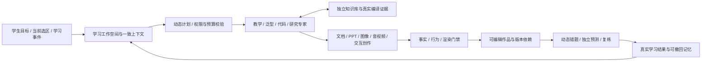

# 泛型工坊 TypeForge · Agent 学习工作空间

以 **Java 泛型与类型安全** 为课程知识主线，让动态专家集群围绕学习目标、代码实验、资料与作品持续协作。学生可以自由组织学习过程，制作可编辑 PPT、文档、图解/图片、音频、视频和高交互错题集；作品与知识引用、真实编译证据、复练结果相互联动。

**当前交付是 v0.2 架构基线。** 包含 16 个模块的详细设计、14 类专家的编排规则、65 个 API 操作契约、51 张 MySQL 表、8 类作品的结构化协议、Java 工程骨架、可执行的计划校验与泛型语义测试，以及前端样式/交互研究。实际业务接口仅有健康与框架说明两个 GET。前端、业务数据库接入、模型/媒体适配、持久任务调度和编译沙箱均待深度开发。通过基线检查不代表完整平台已建成。

## 阅读入口

1. [整体框架与评分映射](docs/00-blueprint.md)：范围、16 个模块、两人 96+ 目标的证据要求。
2. [动态专家集群](docs/10-agent-cluster.md)：任务图、路由、接续、并行、记忆、预算、取消与质量门禁。
3. [多模态作品与动态错题集](docs/11-learning-artifacts.md)：PPT/文档/图像/音视频/交互作品如何制作、编辑和联动。
4. [模块详细设计](docs/02-modules.md)与[架构数据流](docs/01-architecture.md)：每个模块的职责、实现步骤、输入输出与故障处理。
5. [前端样式与交互](docs/07-frontend.md)：工作空间布局、设计 token、参考机制与组件状态；本次未制作页面。
6. [三项目借鉴研究](docs/12-reference-research.md)：OpenMAIC、Superagent 原型、Harness 的固定版本、实际阅读范围与采用边界。
7. [两人开发计划](docs/09-team-plan.md)、[质量要求](docs/08-quality.md)、[实际检查记录](evidence/baseline-review.md)。

## 主链路



专家提出计划和修改建议；服务端决定资源权限、执行范围、费用预留与提交版本。Java 泛型体现于 `AgentTool<I,O>`、作品版本端口、类型实验和确定性校验；JSON Schema、事务和隔离 worker 负责跨进程与不可信输入边界。

## 目录

| 目录 | 内容 |
|---|---|
| `backend/` | Spring Boot、16 个模块边界、泛型语义测试、任务 DAG/并发候选选择内核 |
| `contracts/` | OpenAPI 3.1、115 个 Schema、操作索引与模块清单；implemented/planned 分开 |
| `database/` | 两份迁移、两份逐字段字典、草稿种子；当前未接业务适配器 |
| `agent/` | 专家/能力登记、运行策略、计划样例、评测设计、提示词边界 |
| `knowledge/` | 16 个概念种子与权威来源索引；后续扩为完整审核知识库 |
| `frontend/` | 样式 token、209 条前端参考取舍及源码研究状态 |
| `docs/` | 总体设计、模块、数据、接口、知识、专家、作品、样式、开发和验收 |
| `scripts/` / `.github/workflows/` | 契约/架构资产校验、真实 MySQL 完整性验证、Java CI |
| `evidence/` | 本次实际检查、需求追踪、真实对话摘录与限制 |

## 检查与启动

依赖 JDK 17、Maven 3.9.x、Python 3.12；SQL 验证使用 Docker/MySQL 8.4.5。骨架启动暂不需要数据库或 API Key。

```sh
python -m pip install -r requirements-dev.txt
python scripts/verify.py
mvn -f backend/pom.xml verify
python scripts/verify_mysql.py
mvn -f backend/pom.xml spring-boot:run
```

访问 `http://localhost:8080/api/v1/health` 与 `http://localhost:8080/api/v1/framework`。默认只监听 `127.0.0.1`，其他请求被安全过滤器拒绝。容器构建见[运行约定](docs/08-quality.md)，数据库导入见[数据库说明](database/README.md)。

两人组已由用户确认得到教师认可。课程为团队成果 95 分＋个人贡献 5 分，内部规划团队 ≥92/95、各自争取 5/5，目标各 97；最终分数由教师评定。AI 协助生成的本次基线如实记录，不能替代两位同学后续真实实现、评审和答辩成果。
