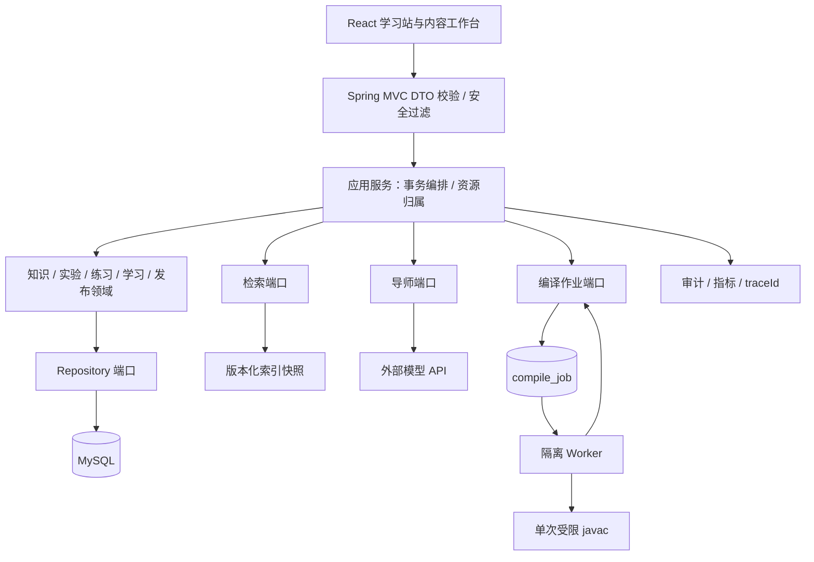
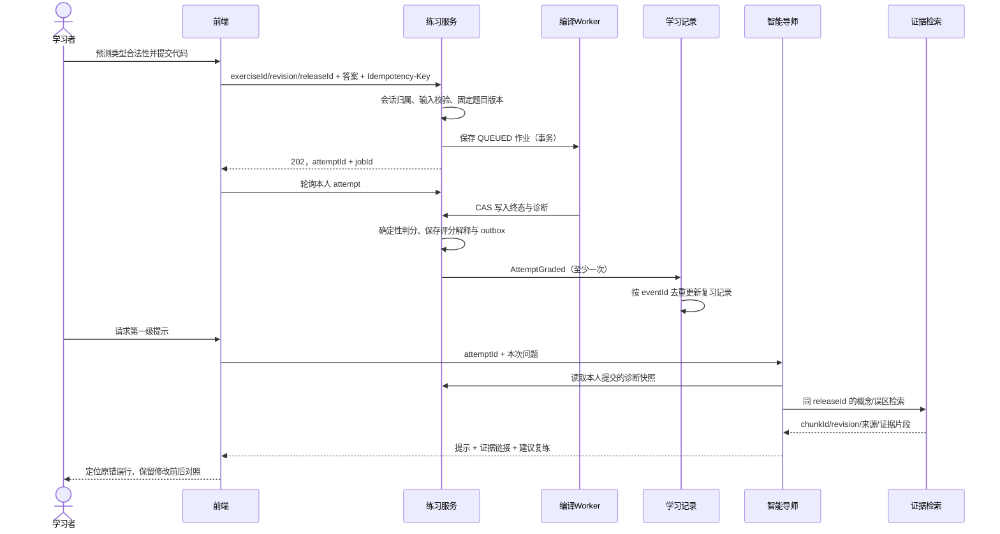
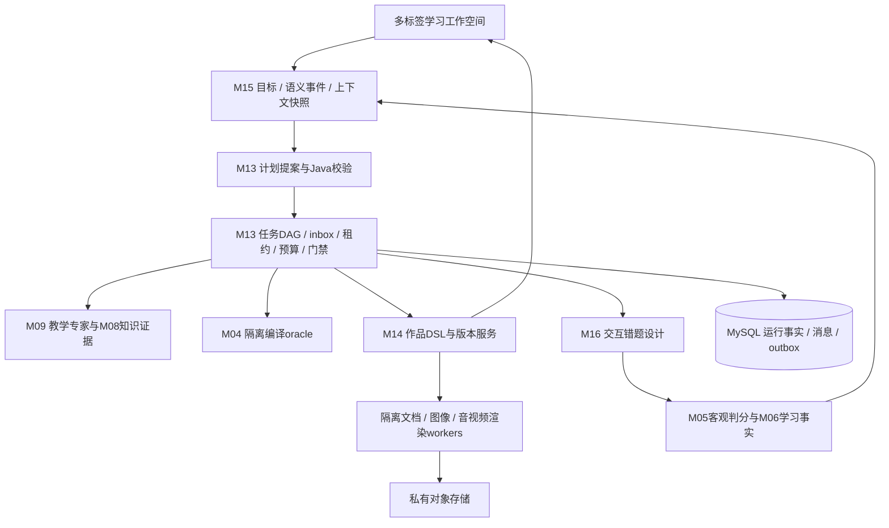

# 架构、交互与一致性

本章连接当前运行机制和完整目标。v0.6 已落地真实学习前端、SQL/HTTP、导师与受限专家工作流、独立编译 worker、私有素材、Office/PDF 导出及双人内容审核发布；通用自治、程序执行、媒体生成等扩展仍属后续设计。准确范围见 [模块接手指南](02-modules.md)、[后端说明](../backend/README.md)与[本轮记录](../evidence/runtime-review.md)。

v0.6 新增有界 TXT/MD/DOCX 批量资料加工、知识/题目修订对比、独立审核的 TEXT 精确判分、六类可恢复错题交互、私有检索评测和管理员运行指标，并将概念前置关系接入学习页面。具体边界、容量和联动见[本轮实现](24-evaluation-import-and-notebook.md)。

## 1. 技术基线与决策

| 层 | 选择 | 理由与边界 |
|---|---|---|
| 语言 | Java 17，`--release 17` | 统一教学和服务基线；不启用 preview；泛型案例用实际 javac 核对 |
| 服务 | Spring Boot 3.5.16、Maven 3.9.x | 固定补丁版本并构建验证；Java 17 在官方兼容范围内 |
| 持久化 | Spring JDBC + Flyway；MySQL 8.4 目标，H2 本地默认 | 已采用显式 SQL 与短事务；H2 与 MySQL 分别配置迁移，二者验证结果分开记录 |
| 前端 | React、TypeScript、Vite、原生 CSS | 已实现学习工作台并锁定 package-lock；参考交互逐项映射，研究台账不等于全部演示已运行 |
| 检索 | 发布/概念过滤 + 本地词项 BM25 | 当前中文二元词、英文标识符分词，直接读取已发布 SQL 卡片；词典、持久索引和向量增强仍待实施 |
| 模型 | `TutorAnswerProvider` + Java HTTP 客户端 | 非流式 Chat Completions 协议；结构、引用与计量校验；缺配置时 MODEL 不可用 |
| 作业 | 数据库任务表 + 受控适配器 | 证据/学习 DAG、导师、编译与文件导出分别控制租约/终态；HTTP/渲染不占数据库长事务；媒体 worker 尚未接入 |
| 通信 | REST；长任务轮询；Agent 后续可选 SSE | 首版先实现可恢复轮询，再添加流式显示；中途断开不等于成功 |

Spring Boot 兼容性依据：[官方系统要求](https://docs.spring.io/spring-boot/3.5/system-requirements.html)。版本更新先做依赖漏洞检查与回归，不能盲追最新。

## 2. 架构图

目标分层要求领域规则不依赖 Controller、HTTP 或供应商 SDK，Controller 只调用应用服务。v0.6 采用显式 JDBC 应用服务落实事务与归属，尚未把所有 SQL 拆成独立 repository adapter；后续按业务稳定程度拆分，不能把目录形式当作已完成解耦。共享模块只放通用 ID、分页、错误、JSON/Schema 与版本边界，不承接全部业务逻辑。闭户通过 `AccountClosureParticipant` 端口回调各模块，避免 identity 反向依赖业务形成环。

API JVM 永不编译或运行用户代码。`CompileWorker` 通过固定 HTTP 协议调用独立 broker，后者以无网络、非 root、只读根文件系统、资源/时间上限和 `-proc:none` 容器进行编译，不执行产物。API 内的 JavaCompiler 测试只编译仓库固定案例；真实 Docker 隔离检查是独立 CI 门禁，不能以协议测试代替。

## 3. 核心身份与版本

外部 ID 统一 UUID 字符串，数据库 `CHAR(36)`；计数用普通整数，不把数据库大整数直接交给 JavaScript。时间使用 UTC 的 ISO-8601，显示按用户时区。一个 `requestId` 只用于跟踪，不承担授权；用户身份来自会话。

知识卡和题目以稳定 ID + revision 定位；`content_release` 是一次不可变发布清单，包含具体 chunk、exercise 版本及索引哈希。当前版本由 `active_release` 单行指针标识。学习活动、题目提交、编译作业、检索结果与 Agent 回答都保留 `releaseId`。禁止覆盖已发布内容。

编译结果额外保留 `jdkVersion`、`compilerFlags`、`sourceHash`、`jobId`；判分保留 `rubricVersion` 和 `graderVersion`；智能回答保留 prompt/model/retrieval 版本、引用 ID、调用消耗。这样才能解释“同一道题以前为什么这么判”。

## 4. 主链路时序

## 5. 数据传递矩阵

| 起点→终点 | 输入/输出 | 一致性要求 | 失败策略 |
|---|---|---|---|
| M10→M02/M05/M08 | releaseId 与审核后的版本清单 | 发布指针仅在索引就绪与校验完成后切换 | 构建失败不改变在线版本 |
| M02→M03/M05 | conceptId、releaseId、示例/题目 ID | 所有目标必须存在于该发布 | 找不到则提示旧版不可用，不跳到任意新版 |
| M03→M04 | 源码、支持范围、规则版本 | 实验解释与编译结果分开返回 | 未支持语法标记 UNSUPPORTED，不猜结论 |
| M05→M04 | attemptId、题目版本、源码哈希 | 代码更新生成新提交；旧结果不能覆盖新提交 | 超时记基础设施失败，不判学习者错误 |
| M04→M05 | 诊断码、位置、退出状态、截断标记 | worker leaseToken + 终态 CAS | 重复/迟到结果拒收，保留审计 |
| M05→M06 | AttemptGraded/eventId/concept 贡献 | 与评分同事务写 outbox；消费幂等 | 可重放；仪表盘提示更新延迟 |
| M06→M09 | 经授权的最近误区与证据摘要 | 只传当前用户最少必要数据 | 缺上下文退化为一般教学，不伪称个性化 |
| M08→M09 | 来源、片段版本、过滤后得分 | 不跨发布拼接；不把检索分数当正确率 | 证据不足返回明确缺口 |
| M09→M05 | suggestion：练习 ID 与理由 | 只能推荐；不可直接更改判分 | 题目已退役提示更新，保留历史引用 |
| M11/M12←全部 | 测试/审计/traceId | 不记录密钥、密码或完整私人代码 | 采样与脱敏，故障不泄露内部堆栈 |

## 6. 关键状态机

编译：`QUEUED → RUNNING → SUCCEEDED | COMPILE_ERROR | RUNTIME_ERROR | TIMED_OUT | RESOURCE_LIMIT | INFRA_ERROR | CANCELLED`。`SUCCEEDED` 表示请求模式完成，不表示答案正确；编译通过仍可能有警告。请求 `COMPILE_ONLY` 时禁止进入运行阶段。终态不可修改，重试建立新作业并关联旧作业。

题目提交：`PENDING → GRADING → GRADED | FAILED`。语法错误在“判断编译失败”题中可能是正确答案，由题目的明确规则决定；不能把所有编译错误当作零分。基础设施失败进入 FAILED，不写掌握度。

发布：`DRAFT → VALIDATING → PUBLISHED → RETIRED`；校验失败回 DRAFT 并记录错误。回退通过选择历史已发布版本并原子切换指针，不修改历史 release。被撤回的有误内容保留受限审计记录，旧回答显示“依据已撤回”。

导师请求：`QUEUED → RETRIEVING → GENERATING → VALIDATING → COMPLETED | INSUFFICIENT_EVIDENCE | FAILED | CANCELLED`；这些是可见工作阶段，不展示模型隐含推理过程。

## 7. 事务、并发与可靠性

1. 接受提交：对 `(userId, operation, idempotencyKey)` 唯一；保存规范化请求哈希。相同 key/相同请求返回原资源，不同请求返回 409。key 过期不删除已有 attempt 去重关系，接口约定保留 24 小时。
2. 接受编程题提交时，attempt 与 compile_job 同事务；worker 使用 `SELECT ... FOR UPDATE SKIP LOCKED` 抢占，提交 leaseToken、leaseUntil、attemptNo。过期租约最多自动重投 1 次；新租约废除旧 token。
3. 评分结果、outbox 同事务提交。消费者用 `(consumer,eventId)` 唯一键，把去重凭据与 projection 更新放在同事务。不能宣称网络端“恰好一次”。
4. 稿件通过 baseRevision 乐观锁创建新 revision，旧值返回 409；偏好使用 If-Match，旧值返回 412；发布采用数据库行锁。FK 保证存在性，发布成员关系和跨表版本一致性仍由事务校验与测试保证。
5. 外部模型、向量服务调用不得占用数据库长事务。先保存请求、释放事务、调用、再以版本/CAS 回写。断线后由 requestId 查询状态。
6. 输入、输出、队列、重试均有上限。分页与游标按具体契约：当前练习使用稳定 ID keyset，事件使用各自 stream sequence；其他短列表受 limit 限制。后续时间线可采用 `(createdAt,id)` keyset，不把所有资源假设成同一种游标；实际索引与负载另行验证。

## 8. 缓存与失效

知识缓存键为 `releaseId:conceptId:revision`，发布生成新键；用户记录缓存包含 userId。检索缓存含 releaseId、过滤器和规范化 query；私有提问不共享缓存。编译缓存只允许审核过的公共示例按 sourceHash+JDK+flags 键缓存，不跨用户暴露源码。权限撤销与敏感内容撤回必须绕过旧缓存。

## 9. 架构不变量

- 浏览器不收到标准答案、隐藏测试或模型密钥；判分与权限只在后端决定。
- 学习完成不等于掌握；AI 提示、直接看答案与独立答对分开记录。
- 编译器事实优先于教学规则图和模型解释；冲突进入缺陷列表。
- 无来源的模型输出不进入知识库；新内容必须经过 M10 审核。
- 当前已有数据库应用服务、HTTP 边界、真实容器编译和 Chromium 页面检查；通过范围以本轮验收记录及对应提交的 CI 为准。生产安全、负载/恢复、真实模型、隔离 worker 的目标环境部署，以及未覆盖的跨设备与辅助技术交互仍须专项验收。

## 10. 工作空间与专家集群主架构

API与控制面使用Java；模型/媒体供应商、文档解析和渲染通过受限适配器连接。前面的课程闭环是这一主架构中的教学子链。`TutorAnswerProvider`是当前导师回答适配端口；未来总协调器通过注册表调度14类专家与16项能力，不能将这些规划角色视为已接通。跨模块传递资源引用和小型结构化事实，不传任意shell，不把多媒体二进制放入专家群消息。

| 数据连接 | 传输内容 | 关键校验/失败恢复 |
|---|---|---|
| M15→M13 | goalId/snapshotId/releaseId/期望产物/预算 | 同owner同workspace；事件去重；已有run接续 |
| M13→M09/M14/M16 | nodeId/role/inputRefs/acceptedTools/epoch/lease/deadline | 严格schema、工具能力与范围；不让模型扩大权限 |
| M09/M04→M14 | 经核验结论、证据引用、sourceHash/diagnostics | 编译冲突退回事实核查，不将投票当事实 |
| M14→worker | 固定DSL版本、只读素材引用、导出键 | 无主站cookie/数据库凭据；禁任意外链；限时限量 |
| worker→M14→M13 | 私有assetId/hash、报告、成本/状态 | epoch+lease+baseRevision CAS；迟到候选不覆盖 |
| M14→M16→M05/M06 | 错题块、合法action、真实attempt结果 | 绑定本人原题与release；未验证变式不判分 |
| M06/M14→M15 | 真实学习事实/作品更新事件 | 一致事件序号；撤回/变更使记忆和选区失效 |

上下文/计划/作品版本分别独立，不把一个全局revision混用于全部对象。计划版本更新时撤销受影响节点的租约并提高runEpoch；保留未受影响的已核验产物，显式链接到新计划输入。必需分支失败可交付 PARTIAL，但不得标 COMPLETED。细节见 [集群](10-agent-cluster.md)与[作品](11-learning-artifacts.md)。
