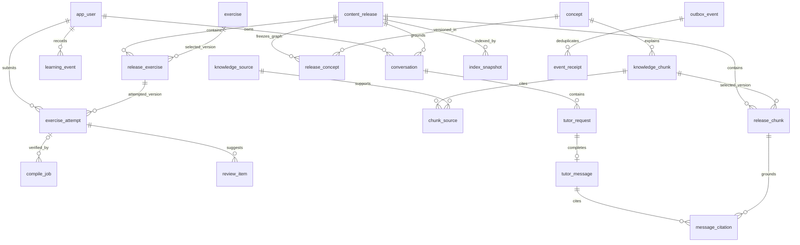
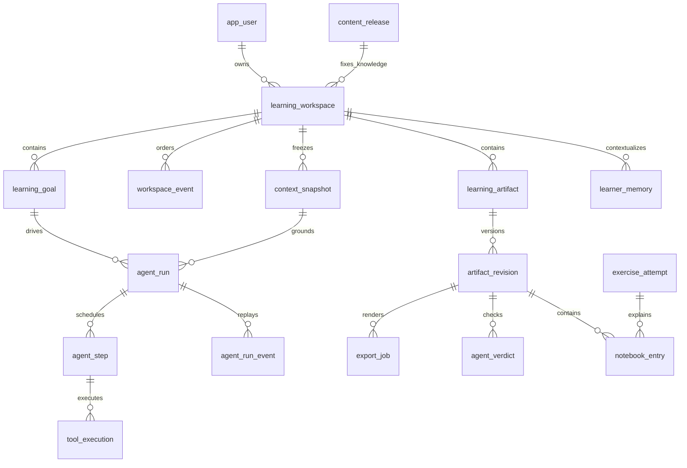

# 数据模型、数据库与隐私边界

## 1. 结构

数据库含 [V001](../database/V001__baseline.sql) 的31张课程表和 [V002](../database/V002__agent_workspace.sql) 的20张工作空间表，共51张。字段、约束与索引见 [课程字典](../database/data-dictionary.md)及[Agent字典](../database/agent-data-dictionary.md)。这是可实际建库的设计基线；应用尚未连接数据库，不能将建表成功等同于业务实现完成。

此 ER 为核心关系图，完整辅助表和所有 FK 以 SQL/数据字典为准。`concept_edge` 是编辑中的前置关系；发布时复制为 `release_concept` 的标题与前置 ID 快照，阅读必须按发布读快照，避免后续调整概念图影响旧学习记录。

## 2. 聚合与写入责任

| 表组 | 唯一写入模块 | 读者 | 约束 |
|---|---|---|---|
| app_user / user_preference | M01 | 各模块经权限服务 | 规范化账号唯一；密码仅散列 |
| concept / concept_edge / source / chunk / chunk_source | M07/M10 | M02/M08 | 卡片 id+revision 不覆盖；来源变更新建记录 |
| exercise / exercise_concept | M10 | M05 | 标准答案不进入公共 API；权重合计应用校验 |
| content_review / release_* / active_release / index_snapshot | M10 | M02/M05/M08/M09 | 独立审核；指针原子更新；发布成员不可变 |
| exercise_attempt | M05 | M06/M09 | 固定发布和题版本；终态判分不可覆盖 |
| compile_job / lab_session | M04/M03 | M05/M09 | 归属与 release 一致；租约 CAS |
| learning_event / learner_concept / review_item | M06 | 本人仪表盘/M09 | 事实与投影分离；重复不加分 |
| outbox_event / event_receipt | 发布事件模块/对应消费者 | M12 | at-least-once + 事务内去重 |
| conversation / tutor_request / tutor_message / message_citation | M09 | 本人导师页 | 不跨用户、跨发布引用 |
| retrieval_log / audit_event / idempotency_record | M08/M12/请求模块 | 授权维护者 | 日志最小化，幂等按用户和操作隔离 |

跨模块读取使用应用端口，不绕过服务直接修改另一模块表。多个领域可共享同一 MySQL 事务，但必须由应用服务明确编排。

## 3. 数据库能保证与不能独立保证的事

主外键保证目标存在；复合外键保证提交使用发布中真正存在的题目版本、引用来自该发布的知识卡；唯一键防止重复版本、重复事件凭据和重复幂等 key；CHECK 校验状态、分数和范围。

数据库本身不能从普通 FK 自动保证：attempt.userId 与 compile_job.userId 相同；conversation 与引用的 release 相同；发布时 reviewer 真的是内容作者以外的人且有编辑权限；同发布概念前置均存在且无环；题目权重合计 1；稿件最新 revision 与提交 baseRevision 一致。以上必须在应用事务、授权条件和集成测试中落实。`content_review` 为多态目标，targetId 没有虚构的跨表 FK，应用要校验目标和版本。

## 4. 索引与查询

- 本人提交/实验/会话：`user_id,created_at,id`，按 cursor 翻页。
- 作业领取：`status,lease_until,created_at,id`；事务短，领取后立即提交。
- 概念知识：`concept_id,status`，读已选发布成员；对正文不做无界 LIKE。
- 复习：`user_id,status,due_at,id`；先过滤本人再排序。
- 阅读/评分事实：`user_id,concept_id,occurred_at,id`。
- 发布关联表用复合主键；实际数据量建立后再 EXPLAIN，不凭索引存在声称高性能。

## 5. 迁移、保留与删除

V001 只应用到空数据库，后续增加 V002/V003；不改写已经执行过的迁移。应用阶段接入 Flyway 并使用 schema history，部署前备份、校验迁移兼容性。当前独立验证脚本不连接任何用户已有数据库。

业务建议保留策略：私人临时代码/编译输出 30 天、对话 90 天（用户可提前删）、审计最小元数据 180 天；这是待两人确认的项目配置，不是法律期限。成绩事实与发布快照保留至课程验收完成并根据用户选择导出/删除。`RESTRICT` 避免误级联，删除账户要按依赖顺序删除私有记录或经明确策略匿名化；知识作者署名和审计可采用无个人身份的已删除主体，不能直接删掉被 FK 引用的账户。

outbox 与 receipt 要共同考虑重放窗口，不能先删除 receipt 再把旧事件重放一次。数据清理、备份和恢复都要包含索引快照/发布清单，单独恢复 MySQL 而丢失旧索引不算恢复成功。

## 6. 当前测试数据

`seed-demo.sql` 仅插入禁用的占位作者、8 条来源索引、16 个概念、16 张草稿卡、草稿发布和概念快照。没有可登录默认口令，没有“假通过”的审核、已发布知识库、学习成绩或模型回答；当前 active_release 为空是预期状态。

## Agent 与作品数据链

写入所有者：M15负责workspace/goal/event/snapshot/memory；M13负责run/step/dependency/message/tool/run_event及租约调度；M14负责artifact/revision/asset/export/dependency/verdict；M16负责notebook_entry。只有 M05/M06 可以产生成绩/学习事实。

SQL直接强制：目标和快照必须同workspace；依赖边必须同run同planRevision；素材/作品引用必须同workspace；触发事件去重；调用executionKey唯一；作品版本唯一；写租约一作品一条；预算已花费+预留不超过总额；状态枚举及数值范围。

**需要应用事务和最终业务测试的不变量**：空间必须属于当前会话且release已发布；触发事件、生产步骤、导出结果、原始作答都与目标作品同owner/workspace/release；复合FK未覆盖的跨表关系逐个校验。agent_step.planRevision必须为正在执行计划；run.plan_json与节点/边一致；依赖图和作品派生图无环；所有输入引用合法且未撤回；current_revision必须指向实际存在版本；作品kind与DSL匹配；素材只有CLEAN才使用；verdict不能由作品作者角色自封通过；导出format与kind兼容。

**作品提交事务**：锁artifact→检查baseRevision→检查run.status/epoch、step lease、artifact_write_lease.token/until→再次核对输入撤回状态→插入新revision→更新current_revision→写依赖失效事件与outbox→释放租约→提交。所有业务路径按同一锁顺序执行，死锁有限退避，不跨网络持锁。用户编辑优先：撤销/提升租约epoch后保存自己的分支，旧Agent结果保留为未合并候选，不覆盖用户稿。

**预算事务**：锁run，按最坏可计费量预留；供应商调用完成后以唯一executionKey结算spent/reserved，结果未知继续保留额度并主动对账。总额CHECK提供最后一道保护；模型额度、媒体时长和token也需应用层并行预留。使用整数微美元，API限制金额范围以保持JS安全整数；该单位不是对供应商价格的预测。

**恢复与保留**：事件序号/状态/费用和产物版本是事实，聊天摘要不是事实库；运行重启先恢复租约/对账而非重放全部工具。撤回记忆先禁用内容引用，再清理派生摘要与缓存；审计只留匿名id、操作、时间，不保留删除正文。原始学习结果按用户设置处理，不能借撤回推断记忆悄悄删除真实成绩，也不能让旧快照重新引用已删除记忆。
