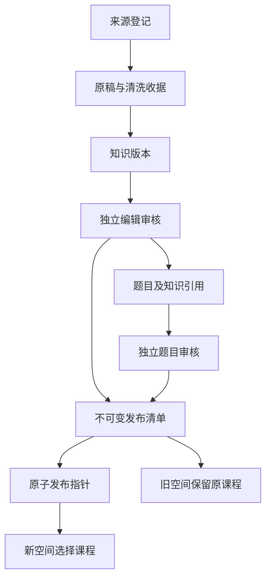

# 数据模型、数据库与一致性边界

## 1. 当前结构：v0.6，14 次迁移，92 张业务表

当前后端通过 Spring JDBC 和 Flyway 读写真实数据库；默认使用持久 H2 文件，MySQL Profile 执行原始 MySQL SQL。**V001–V018 累积 92 张业务表，不含 Flyway 元数据表。** 表结构与字段以[唯一字段字典](../database/data-dictionary.md)为准，业务完成度以[模块指南](02-modules.md)、[接口状态](../contracts/README.md)和实际服务为准。账号生命周期、私有素材、编译队列、受限教学工作流及原生文件导出已有业务实现；这不等于任意执行、全部媒体生成或生产容量已验收。

| 迁移 | 新表数 | 当前作用 |
|---|---:|---|
| [V001](../database/V001__baseline.sql) | 31 | 账户、知识与题库、发布、作答、学习投影、导师基础表、审计与幂等 |
| [V002](../database/V002__agent_workspace.sql) | 20 | 工作空间、目标与快照、持久任务、作品版本、记忆、依赖与运行事件 |
| [V003](../database/V003__runtime_integrity.sql) | 5 | 空间作答关联、题目家族证据、空间投影、作品输入闭包、本地证据工作流；扩展 outbox 重试字段 |
| [V004](../database/V004__tutor_runtime.sql) | 4 | 空间会话关联、按用户日额度、导师持久请求、回答到文档的来源链接 |
| [V005](../database/V005__content_workbench.sql) | 6 | 编辑准入锁、人工采集收据、知识到收据、题目到知识、独立审核证据、发布清单 |
| [V006](../database/V006__interactive_learning.sql) | 3 | 空间实验关联、交互动作收据、真实导出文件内容；扩展导出失败码 |
| [V007](../database/V007__identity_operations.sql) | 3 | 持久会话、认证限流、阅读索引；扩展资料修订、认证epoch与关闭状态 |
| [V008](../database/V008__compiler_learning.sql) | 3 | 空间编译关联、编译准入锁、提示回执；扩展队列租约、诊断及错题动作约束 |
| [V009](../database/V009__artifact_files.sql) | 1 | 真实二进制导出字节、hash及大小；扩展导出租约 |
| [V010](../database/V010__study_workflow.sql) | 2 | 受限教学计划及所选作答、步骤和导师/工具执行映射 |
| [V011](../database/V011__private_assets.sql) | 1 | 私有素材字节及撤回状态；作品来源CHECK增加ASSET |
| [V012](../database/V012__evaluation_workbench.sql) | 5 | 私有评测套件/修订、持久运行、逐项结果、全局准入锁；限定归属、租约、结果体积 |
| [V013](../database/V013__text_and_notebook_interactions.sql) | 2 | 独立 TEXT 审核收据、按作品/块版本的持久状态；追加受控动作 |
| [V014](../database/V014__batch_ingestion.sql) | 2 | 私有批量预览与逐文件结果，绑定来源/采集收据，保留上传 hash 并清理临时正文 |

已执行迁移不得修改或删除。[迁移哈希清单](../database/migrations.lock.json)保护这条升级链；后续结构变化使用新的前向迁移。H2 兼容迁移与 MySQL SQL 是两套实际运行入口，不能用 H2 通过代替 MySQL 行为验证。

## 2. 聚合与写入责任

| 表组 | 写入责任 | 关键不变量 |
|---|---|---|
| `app_user` / `user_preference` / `account_session` / `authentication_limit` | M01 身份 | 规范化账号唯一；密码仅散列；资料/偏好CAS；会话绑定UUID与epoch，认证限流原子计数 |
| `knowledge_source` / `content_ingestion` | M07 人工资料工作台 | 来源不可被收据换绑；原稿、清洗稿与实际内容哈希一起持久化 |
| `concept` / `concept_edge` / `knowledge_chunk` / `chunk_source` / `chunk_ingestion` | M10 内容草稿，读取 M07 收据 | 追加 `id+revision`，不覆盖旧正文；来源和具体采集收据一同绑定 |
| `exercise` / `exercise_concept` / `exercise_knowledge` | M10 题目草稿 | 客观选择结构或经审核的CODE正反编译契约；家族固定；概念权重合计1；知识精确到版本 |
| `content_review` / `content_review_evidence` | M10 独立审核 | 作者不能审核自己；目标版本只有一次终态决定；审核绑定完整 review hash |
| `content_release` / `release_*` / `release_manifest` / `active_release` / `index_snapshot` | M10 发布 | 成员与概念图冻结；清单复验；活动指针 CAS；旧工作空间不自动迁移 |
| `exercise_attempt` / `workspace_attempt` | M05 判分 | 本人、同空间、固定 release 与题版本；终态结果不覆盖 |
| `compile_job` / `workspace_compile` / `compiler_admission` | M04 编译队列 | 固定源码hash及检查清单；队列/租约/取消有界；API JVM不编译用户源码；基础设施失败不生成错误成绩 |
| `exercise_text_review_receipt` | M10 审核、M05 校验 | 完整私有规则 hash、作者之外的真实审核和固定算法版本，不能只凭 REVIEWED 状态判分 |
| `exercise_hint_receipt` | M05 提示 | 真实提示回执及题族受助事实；公开接口不泄露隐藏编译检查 |
| `learning_event` / `learning_family_evidence` / `learner_concept` / `review_item` | M06 学习证据与投影 | 事实和投影分开；同人同概念同题目家族最多一个独立样本 |
| `workspace_reading` | M02/M06 阅读历史 | 仅索引真实事件、固定空间/知识点/时间；阅读不生成掌握分 |
| `lab_session` / `workspace_lab` | M03 类型实验 | 有限规则结果或实际独立编译任务、本人预测与固定空间；探索不作为独立掌握证据 |
| `learning_workspace` / `learning_goal` / `context_snapshot` / `learner_memory` | M15 工作空间 | 本人归属；release 固定；目标有版本；快照引用可复验；记忆可撤回或到期 |
| `workspace_event` / `workspace_projection` / `outbox_event` / `event_receipt` | 领域事件生产者、M12 消费者 | 顺序事件；业务与 outbox 同事务；回执与投影同事务 |
| `agent_run` / `agent_step` / 依赖、工具、运行事件表 | M13 持久运行时 | plan revision、epoch、lease 与执行键；预算原子预留/结算；实际执行器按注册能力准入 |
| `local_evidence_workflow` | M09 本地证据适配器 | 私有 query、固定检索适配器；结果明确为证据整理 |
| `study_workflow` / `study_step_execution` | M09 到 M13 的受限教学适配器 | 固定模式/计划/所选作答；每代步骤关联真实导师请求和工具回执；生成作品保持DRAFT |
| `conversation` / `workspace_conversation` / `tutor_request*` / `tutor_message` / `message_citation` / `tutor_daily_budget` | M09 导师 | 同人同空间同发布；队列、取消、来源复验；已派发但结果未知的请求保留额度 |
| `learning_artifact` / `artifact_revision` / `artifact_dependency` / `artifact_input_reference` | M14 作品 | 不可变源版本、显式直接引用与传递闭包；源变更传播过期 |
| `tutor_artifact_link` | M09 到 M14 的应用编排 | 回答、快照、响应哈希与首次文档版本对应；后续学生编辑不抹除来源 |
| `evaluation_suite` / `evaluation_suite_revision` / `evaluation_run` / `evaluation_case_result` / `evaluation_admission_lock` | M11 检索评测 | owner/空间/发布复合外键；定义不可变；租约、分母/指标、真实报告及部分结果容量 |
| `import_batch` / `import_batch_item` | M07 批量加工 | 预览私人归属、source/capture复合外键、原文hash、提交CAS；终态清除暂存文本 |
| `notebook_entry` / `notebook_action_receipt` / `notebook_block_state` | M16 复练 | 本人真实错题；当前作品/块版本；动作幂等并复用实际判分服务 |
| `asset_object` / `asset_payload` / `artifact_asset` | M14 私有素材 | 真实格式、字节、hash与归属；账号总配额；撤回清除字节并同步失效依赖 |
| `export_job` / `artifact_export_content` / `artifact_export_binary` | M14 本地导出 | 固定源版本、渲染器版本、实际文件字节/hash；租约、单项与总缓存有界，下载再验来源 |
| `retrieval_log` / `audit_event` / `idempotency_record` | 对应应用服务 | 日志最小化；幂等按用户和操作隔离；同 key 不同请求拒绝 |

写入通过所属服务；跨模块工作由应用服务编排，不让前端或模型指定 owner、审核人或最终成绩。`ingestion` 不反向依赖 `publishing`；后者读取人工采集收据，公共编辑授权位于 `identity.ContentAccess`，保持模块依赖无环。

## 3. 内容从人工资料进入可学习发布

来源 URL 只作登记，不触发网络抓取。`content_ingestion` 保存用户实际提交的原稿、清洗稿、处理说明、作者和时间；规范化换行后计算两个内容哈希。`chunk_ingestion` 的复合外键使收据不能挂到另一个来源。首次实际采集才填入来源的 `raw_hash`；它表示提交文本的哈希，不证明服务器下载或验证过 URL 全文。

草稿使用 `baseRevision` 比较并追加版本。审核绑定知识标题、正文、来源与收据，或题目完整私有答案、概念权重与知识引用；只对正文做哈希不足以保护题目答案和来源说明。当前“双人”规则是**作者与另一位已授权编辑**，不是两个审核者，也不是系统对现实身份的认证。测试账户和 demo 元数据不算真人审核。

构建 release 时，所有知识和题目都必须有独立批准证据；冻结完整前置概念图，检查无环、前置概念有知识覆盖、题目支持知识属于同一 release。`release_manifest` 保存确定性清单及检查器版本，`index_snapshot` 记录实际 SQL BM25 语料校验；`READY` 不表示构建了向量文件或完成模型质量评测。

发布事务重新计算审核和清单哈希，核对真实索引记录，再比较 `expectedActiveRevision`，一并写入 `PUBLISHED`、发布时间、活动指针和审计。失败整笔回滚。历史激活只接受已发布的正式清单，同样复验；原发布时间和成员不变。幂等重放返回资源当前视图，不会把后来已切换的指针再次激活。新 release 可由 M02/M08/M05 直接读取；所有已有 `learning_workspace.release_id` 保持不变。

## 4. 统一引用与当前有效性

API 中的资源引用为 `kind / id / revision / contentHash`。owner、workspace 和 release 由当前会话及关联表验证，不能信任请求自行声明的归属。当前源引用包括 `GOAL`、`MEMORY`、`ATTEMPT`、`KNOWLEDGE_CHUNK`、`ARTIFACT`、`ASSET`；作品保存不接受尚未实现展开语义的 `SNAPSHOT` 引用，应使用明确源项。所选较早作答必须属于本人空间和同一课程，并经过真实判分，不能靠传入UUID扩大授权范围。

`artifact_revision.input_refs` 是直接来源清单，`artifact_input_reference` 是持久化的传递闭包。保存最多 64 个直接来源、256 个不同的直接及间接来源；同一类型/id 经两条路径出现不同 revision/hash 时拒绝，不静默选择一版。

当前已实现的上下文读取、导师、作品保存、复练动作和导出，在消费 `ARTIFACT` 输入时统一进入 `WorkspaceService.validateReferences`。未来自动作品输出适配器也必须复用完整来源校验，不能只比较数据库里的 hash 字符串。该校验：

1. 从真实 `content_json` 重新计算 root 与祖先作品哈希；要求当前版本和允许使用的状态。
2. 从直接清单有界展开到 256 项，核对每个祖先直接清单属于自身索引，祖先索引属于根闭包，最终闭包完全一致；拒绝缺索引、额外边、冲突版本和循环。
3. 对非作品叶子分批复验归属、release、实际内容哈希、状态及时间有效性；同次验证缓存已读祖先，不为每个祖先递归重跑整套闭包。

因此，自然到期的 MEMORY 即使没有触发显式 revoke 事件，也不能通过“先派生作品 A，再派生 B”继续进入旧上下文或下载。显式目标编辑、记忆或素材撤回、作品换版同步传播 `STALE`。素材撤回同时清空原始字节；不能只改页面标记。这两层分别处理主动变化和被动时间变化，只有事件传播不能替代消费时复验。

## 5. 事务隔离与锁顺序

共享 `TransactionTemplate` 明确使用 **READ_COMMITTED**。MySQL 默认 REPEATABLE READ 下，事务先普通读、后等行锁，再普通读可能仍看旧快照；单独加锁不足以保证锁后的普通读看到新额度。本仓库保留准入行锁，并用实际 MySQL 的双事务屏障及 REPEATABLE READ 负对照验证这一行为，见[隔离回归](../backend/src/test/java/io/typeforge/TransactionIsolationTest.java)。

| 写路径 | 锁顺序及事务边界 |
|---|---|
| 私人空间、学习动作、作品、导出 | 当前用户 → 工作空间 → 具体作品/任务等对象；先锁归属，再复验与写入 |
| M13 运行控制 | 当前用户 → 工作空间 → run；校验计划 revision、epoch、lease 后改变状态或账本 |
| M11 评测 | 当前用户 → 工作空间 → suite → run；准入额外取全局排队锁；实际检索不占SQL事务 |
| M09 导师 | 当前用户 → 工作空间 → request；准入/派发标记/完成各自短事务，外部 HTTP 在事务之外 |
| M07/M10 编辑 | `content_workbench_lock(1)` → 当前编辑用户 → 目标版本/release → `active_release` |
| 启动授权配置 | 非空配置先取同一编辑锁，再取待提升的用户行；全空配置无动作 |
| 账号关闭 | 当前用户 → 按UUID顺序的全部本人空间 → 各领域撤回参与者；所有参与者处于同一事务，不执行外部HTTP |

编辑侧粗粒度锁适合当前两人团队，使版本、审核、清单和指针决策串行。它限制写入吞吐，但避免多处局部锁难以审查的竞态；锁内不抓网页、不调用模型。启动授权也采用这一顺序，避免滚动启动时与“审核人行锁 + 作者外键锁”形成锁环。

`TYPEFORGE_EDITOR_USERS` / `TYPEFORGE_ADMIN_USERS` 只提升已存在的 ACTIVE 账户，并写审计；没有默认密码、自动建号或 HTTP 自我升权。角色只允许 `LEARNER / EDITOR / ADMIN`，未知名称不获授权。编辑读写都复查当前数据库角色，旧会话不能绕过撤销。

用户保存作品时先比较 `baseRevision`、验证 DSL 和完整输入闭包，再追加版本、撤销旧作品写租约、更新 current revision 并写事件。M13 的 lease/epoch 防止过期执行实例提交；**当前已注册执行链不等于任意多专家生成器已经实现**。未来自动写作品必须复用相同版本、归属和来源准入，不能仅因持有任务 ID 就绕过用户版本。

## 6. 学习、运行、导师与导出账本

真实作答由服务端按固定题目版本判分，再持久化学习事件、outbox 和归属关联。消费者在同一事务写回执与学习投影，重复投递不会重复累计。题目家族去重限制独立样本；看过提示的复练和 notebook 提交保留辅助标记。阅读完成与类型实验属于活动事实，不因停留时长或重复点击增加掌握度。

M13 保存运行/步骤/依赖、顺序事件、工具 execution key 和整数微美元/token 预算。先按上限预留，结算以执行键幂等；外部结果未知时不能当作未执行释放费用。当前 StudyWorkflow 已实现 EVIDENCE_ONLY 或显式配置 MODEL 的受限规划、1～3项教学分工、审阅和 DRAFT 输出，计划与每代请求均可追踪；仍不能执行任意工具。通用账本的微美元字段不等于当前供应商账单已核对，现有适配器不虚构货币价格。

M09 当前提供明确标识的 `EVIDENCE_ONLY`，以及仅在服务器配置有效时启用的 `MODEL` HTTP 适配器。导师请求固定快照和证据，使用租约、epoch、绝对截止时间及 UTC 日额度；HTTP 派发前记账，崩溃后对已派发而结果未知的请求不盲重放。`used_tokens` 是经边界校验的供应商自报用量，不是已核对的货币账单。实际端口为 `TutorAnswerProvider`。

M14 当前真实文件范围包括 Markdown、HTML、SVG、DOCX、PPTX、PDF，幻灯片内嵌授权 PNG/JPEG。队列领取和提交为本人/空间锁下的短事务，实际渲染在事务外；提交时重新检查源版本、lease和完整来源，将字节、hash、大小与成功状态一并提交。输出单项8MiB、账号缓存256MiB，过时缓存回收而任务元信息保留。固定 renderer 不可用、源码损坏、来源变旧或到期时受控拒绝，不返回假文件。

私有上传支持 PNG/JPEG/PCM WAV/MP3/MP4，单项8MiB、账号默认100MiB，保留真实字节与结构检查结果并支持授权Range下载。该能力不包含防病毒认证、生成式图像、TTS或视频时间线渲染。输出不执行源稿HTML/JavaScript，不拉取任意网络素材；文件成功不构成教学事实已核验。

## 7. 数据库保证与应用保证

主外键保证目标存在；复合外键保证发布中的题版本、来源收据归属和部分空间关联；唯一键防重复版本、审核终态、幂等键及消费回执；CHECK 限制状态、分数、预算与数值范围。

普通外键不能证明“当前会话有权访问”“审核人不是作者”“所有源仍有效”“概念图无环”“答案语义正确”“权重合计 1”“发布清单与实际内容相符”。`content_review` 与统一源引用包含多态目标，不虚构一个能跨任意表的外键。这些条件由服务、事务和正反向集成测试落实。发布不可变是应用写入协议；高权限直接改库仍可能破坏数据，重验应拒绝被破坏的内容，不能声称 SQL 已禁止一切管理员修改。

查询先按 owner/workspace/release 缩小范围。当前编辑列表限制 1–100 条、发布清单最多各 1,000 个知识/题目引用、概念闭包最多 100 个；不同页面的列表/游标能力以接口为准。不要把预留索引写成所有接口已有游标分页，也不凭索引存在宣称高负载性能；实际规模建立后再测量并用 EXPLAIN 核验。

## 8. 迁移、保留、删除与测试数据

独立 SQL 验证只使用专用测试数据库；MySQL 服务回归需要显式命名的 loopback 测试连接，不能连接用户的现有业务库。`verify_mysql.py` 检查原始迁移与约束；`verify_transaction_isolation.py` 检查实际隔离语义；`verify_content_mysql.py` 复跑内容事务；`verify_private_modules_mysql.py` 复跑账户/素材；`verify_v06_modules_mysql.py` 复跑新增评测、导入、版本比较、TEXT 与 Notebook，均要求实际 JDBC 引擎证据。HTTP smoke 检查文件库和 MySQL 的真实重启持久化。模式门禁验证 V001–V018 的完整升级链，精确的表数、检查数和各服务结果由真实运行报告生成。最终运行结果和环境统一记录在[验收记录](../evidence/runtime-review.md)，测试源码或报告文件名不等于执行通过。

`seed-demo.sql` 用于独立结构检查，只含禁用占位作者、来源索引、概念与草稿，active_release 为空。显式 `demo` Profile 则保存 16 个概念、16 张原创卡、12 道客观题与演示发布，作者不可登录、无默认口令、无学生成绩、无伪造 `content_review`。其 `REVIEWED` 标签不满足正式审核证据；正式构建会拒绝直接把 demo 装成真人审核发布。demo 初始化只在活动指针为空时设置它，不覆盖已有正式课程。

账号关闭已经实现：在固定UUID上停用身份和全部会话，取消未完成导师/任务/编译/导出，归档空间、撤回记忆、清理未完成源码和个性化提示文本、实际上传字节及可再生成导出缓存；历史成绩、已完成证据、源稿和审核保留。普通用户名可用于全新UUID，曾获编辑/管理权限的用户名保持保留；旧请求不能按同名新账号继续访问。跨模块动作通过身份层端口实现，避免领域反向依赖环。

这不是全量个人数据物理擦除。私人临时代码/编译输出30天、对话90天、最小审计元数据180天仍是**待确认的保留建议**，不是已实现定时清理或法律期限。导出全部个人数据、保留期自动化、清理备份及相关索引仍需明确策略和专项实现，不能直接删除仍被FK引用的历史主体。

备份必须包含发布清单、源版本、关联、运行/额度账本与导出数据。outbox 与 receipt 一起考虑重放窗口，不能先删 receipt 再重放旧事件。未来增加外部索引或对象存储后，其版本与恢复校验也应纳入同一次恢复演练。
