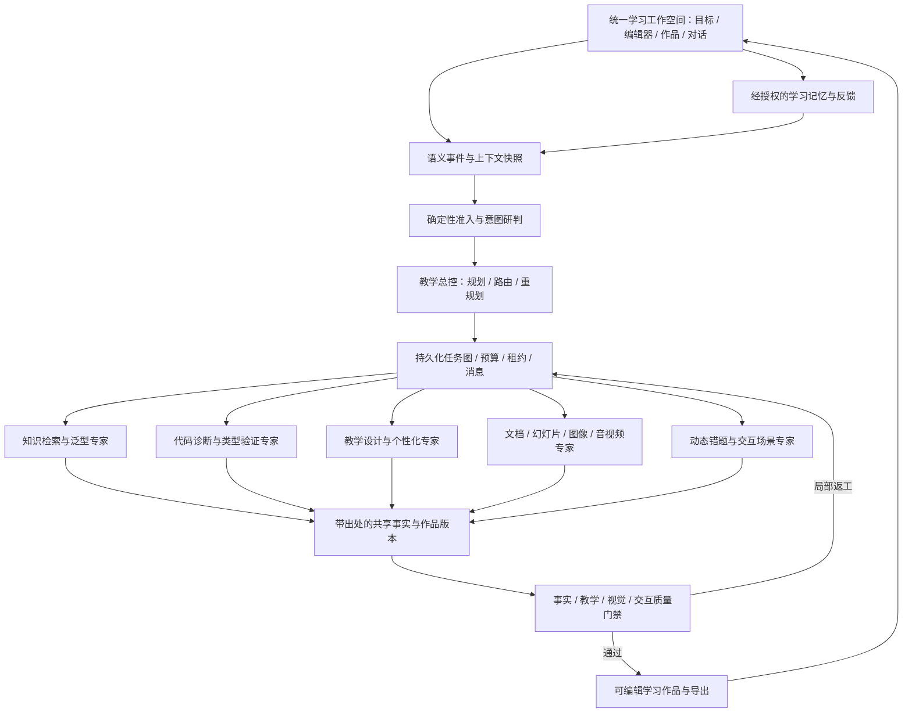

# Agent 专家集群与智能编排：平台核心

这是以学生工作空间和目标为中心的完整专家集群设计。v0.6 已实现持久任务图、本地证据工作流、持久导师请求、显式配置的 HTTP 模型调用，以及受限的规划→专家→独立复核→可编辑草稿学习任务。课程、练习、记忆、私有素材、作品与原生文件导出通过版本化引用联动，用户代码编译由独立 worker 执行。十四角色通用自治、任意工具循环和媒体生产仍是后续目标。当前状态以 [契约](../contracts/README.md) 与运行 capabilities 为准，验证见 [本轮记录](../evidence/runtime-review.md)；当前工作流细节见 [学习任务与原生导出](23-study-and-exports.md)。

课堂集成参考 OpenMAIC 调度器对当前场景证据的固定和向专家的显式交接，以及 DeepSeek Harness 的持久角色/工具注册和运行记录。具体实现沿用现有 Java 事务、任务图和学生的固定课堂版本。课外也可安装仓库内的 DSH bundle，由其官方工具注册表实际加载当前课的资料与下一步建议。复核与依赖的实现说明见 [课堂工作流](23-study-and-exports.md) 和 [Harness 插件](../integrations/dsh-classroom/README.md)。

[OpenMAIC 导演与场景证据源码](https://github.com/THU-MAIC/OpenMAIC/blob/240e8228de8228f949ca90ab10c270f42729f2de/lib/chat/pi/director-loop.ts) · [DSH 会话角色配置投影](https://github.com/deepseek-ai/deepseek-harness/blob/4b399c39a6d1479cd84ca591b4d7c88e24d38a96/packages/preset/agent-preset-registry/src/session.ts)

### 当前执行边界

| 实现入口 | 已执行的行为 | 尚未接入的目标 |
|---|---|---|
| `DurableAgentRuntime` | 持久 DAG、角色/工具准入、lease/epoch、有限重试、预算预留与结果准入、暂停/恢复/取消；区分完整血缘的 `DRAFT_ARTIFACT` 与核验输出 | 自动子图重规划、通用专家调度与外部副作用查询 |
| `EvidenceWorkflow` | 固定两节点调用 `retrieveContext`、`searchEvidence` 两个真实 `AgentTool<I,O>`；输入输出有 schema 和归属检查 | 用自然语言选择任意工具、专家接力或模型回答 |
| `TutorWorker` / `TutorService` | 固定的检索→证据整理或一次模型 HTTP→引用复检流程；持久会话、队列、日额度、取消与恢复 | 自主 conductor、十四角色消息循环、工具调用型模型或自动供应商选择 |
| `TutorDocumentService` | 用户显式把有效回答存为 `DOCUMENT/DRAFT`，完整保留快照与引用血缘，继续接人工编辑及受支持导出 | 模型自动发布、自动标记 `VERIFIED`、媒体格式全覆盖 |
| `StudyWorkflowService` | 固定上下文和目标；本地或模型受限计划；1–3 个允许角色专家；独立复核；DOCUMENT/SLIDES/NOTEBOOK 组装；实际 token 账本、取消与恢复 | 任意工具选择、无限专家接力、自动改写用户作品、真实供应商价格结算 |

`EVIDENCE_ONLY` 使用本地 BM25 片段和固定模板，明确显示未调用模型；`MODEL` 只有在配置 endpoint/model/key 后才调用供应商，无配置时返回 503。`TUTOR_MODEL` 表示配置就绪，不代表外部供应商、事实正确率或教学质量已经通过实测。当前生效的模型系统提示在 `HttpTutorModelProvider` 的 Java 实现中；`agent/system-prompt.md`、`agent/conductor-prompt.md` 与角色清单保留为设计参考，不会在请求中自动加载。具体限制见 [M09 实现与评测边界](06-agent.md)。

## 1. 完整集群的目标使用方式

本节及后续目标结构描述规划中的完整体验。当前已实现的学习任务和可编辑文档/幻灯片/错题集遵循上表；动画、媒体制作、局部自动重规划及任意工具专家接力仍是目标。

学生可以直接说：“我总是分不清 extends 和 super，帮我做一份能操作的错题集、一套讲给同学的 PPT，再做 2 分钟动画。”也可以先拖进自己的代码、课堂笔记、错误截图，选择学习目标、难度、作品形式和指导方式，然后随时打断、改目标、改作品、追加问题。

平台持续理解当前学习情境：正在看的概念、选中的代码、最近编译结果、正在编辑的幻灯片/错题块、明确保存的偏好、本人过往独立练习证据。一个事件可以更新多个专家的上下文；只有需要行动时才激活专家，不把每次鼠标移动都变成一次模型请求。

“高自由度”落实为可编辑目标、可编辑计划、可替换表达形式、局部重做、版本分支、随时暂停/接续、手动控制指导强度。学生能直接操作作品，也能让 Agent 辅助；既有路线学习，也能围绕一个真实问题自由探索。

## 2. 完整集群的目标结构

Java/Spring Boot 已持有业务、权限、持久化编排和任务状态。未来媒体渲染应放独立 worker（Node/Python/FFmpeg 等通过受控协议），不会把整个课程后端改成第三方 TypeScript 项目的复制品。多 Agent 不等于多微服务；未来角色可共享模型进程，按任务建立隔离的上下文和工具集。

## 3. 十四个规划角色与可验证职责

以下十四种职责构成角色设计。当前有限工作流实际使用部分角色完成规划、专家回答、独立复核和作品组装，模型模式通过同一持久导师协议执行；`agent/roles.json` 与能力矩阵标明 partial/planned，不表示十四个通用自主专家全部运行。

| 角色 ID | 负责的决策/产物 | 允许能力 | 验收与冲突裁决 |
|---|---|---|---|
| conductor | 目标澄清、任务分解、选专家、合并结果 | 读上下文、计划提案、派工、结果合并 | 计划必须通过 DAG/权限/预算校验；不能绕过运行时 |
| learning-designer | 目标→前置→示例→练习→反馈的教学结构 | 知识图、学习证据、课程 DSL | 每一活动关联学习目标，避免只生成漂亮材料 |
| generics-expert | 泛型规则、条件、反例与概念关联 | 同发布检索、编译事实 | 规范+真实编译优先，不以多 Agent 投票代替事实 |
| code-coach | 代码定位、签名改造、错误解释 | 本人代码、受限编译/测试 | sourceHash 对齐；基础设施错误不归责学生 |
| retrieval-researcher | 查找、比较与整理证据 | 已授权知识库；可选受限联网检索 | 记录来源/日期/版本；外部材料不能自动入库 |
| learner-coach | 指导节奏、提示级别、复练策略 | 明确偏好、独立样本与误区事实 | 不从停留时间推断人格/能力；建议可解释、可关闭 |
| document-author | 学习笔记、讲义、总结、报告 | 文档 DSL、引用、文档导出 | 结构/引用/样式校验与最终分页检查 |
| slide-designer | 大纲、页面叙事、图文、演讲备注 | Slide DSL、图形、图表、预览、PPTX 导出 | 文字不溢出、阅读顺序清楚、对象可编辑 |
| visual-explainer | 类型关系图、流程图、说明图片 | 精确 SVG/图表或图像模型 | 关系与箭头由结构化事实约束；生成图不充当编译证据 |
| audio-director | 讲解脚本、TTS、字幕、发音词典 | 音色白名单、音频合成、时间标记 | Java 术语发音与字幕一致；不得自动仿冒他人声音 |
| video-director | 分镜、旁白、场景时长和视频合成 | Timeline DSL、已有素材、渲染 worker | 帧、音频、字幕和知识版本一致；可重做单个镜头 |
| interactive-builder | 动态错题集、模拟器、操作任务 | 受控交互 DSL、题目/编译 API | 交互必须实际可用；不注入任意可信主站 JS |
| fact-checker | 独立事实与引用核验 | 规范、编译 oracle、证据匹配 | 与作者分离；无法裁决保留争议并阻止“已核验”状态 |
| experience-reviewer | 教学、布局、交互、无障碍、可播放性检查 | 作品预览、规则检查、受限浏览器测试 | 给出问题位置/严重度；模型评价不代替工具校验 |

目标是按任务选用角色，不要求每次启动 14 个 Agent。未来简单问题可由 generics-expert 加必要检索完成，复杂作品再组建相关专家。角色数不是智能水平指标，任务达成率、事实正确性、减少返工和学习效果才是。

## 4. 智能编排机制

### 4.1 事件准入与主动指导

当前已有服务器语义事件、去重、workspace revision/sequence、outbox、上下文快照与可编辑指导偏好。下面的自然语言意图分类、自动专家唤醒与主动建议冷却策略仍待实现；保存 `COLLABORATIVE` 偏好不代表后台已经自动发起模型调用。

客户端只发送契约中的 `VIEW_CHANGED/SELECTION_COMMITTED/HELP_REQUESTED/DRAFT_CHANGED`。提交、编译完成、正式作品保存、目标修改等事实由对应后端服务产生，不能相信客户端自报成功。指针移动和按键在本地合并；源码只按保存/提交/明确分享时发送。事件含id、受限引用与expectedRevision，workspace由路径指定，时间/sequence由服务端生成。

确定性层先做鉴权、去重、节流、敏感字段过滤、能力/预算检查；意图层再决定 `OBSERVE/SUGGEST/CONTINUE_RUN/CREATE_RUN/REPLAN`。已有运行相关事件注入该运行的收件箱，避免为每次跟进创建新任务。正文中的指令或外部资料只提供上下文，不扩大工具权限。

用户可选：按需 ON_DEMAND（仅明确请求行动）、协作 COLLABORATIVE（关键时刻主动建议）、安静 QUIET（关闭主动建议与非必要通知，已发起任务仍可完成）。默认协作指导只对关键挫折/目标变化提供可用建议；连续同类提示合并，用户拒绝后进入冷却期。学生始终可暂停所有主动指导、查看/删除记忆，不做系统外活动采集。

### 4.2 目标分解与动态任务图

当前 `PlanValidator` 与持久运行时共同校验计划的 DAG、角色、工具、预算及执行身份。`StudyWorkflowService` 已让 conductor 通过持久导师请求返回严格有限 JSON，服务端验证 1–3 个允许专家并构建真正的 `AgentPlan`；模型不能直接指定任意工具、写入范围或绕过预算。专家和复核同样产生可追踪请求，最后组装 DRAFT；本地模式使用明确的确定性计划。分支改稿合并与按新目标自动重规划仍是扩展目标。用户改动尚未应用的规划稿会使工作流暂停，不能偷偷重放旧计划。

conductor 输入为目标、已有作品、学习证据、可用工具与预算快照，输出 `AgentPlan`：runId/revision/runEpoch/goal/budget/steps。每个step包含id、role、dependencies、readScopes、writeScopes、tools、required、acceptance、maxModelSteps，与Java记录和OpenAPI一致。输入/输出引用落在agent_step；各工具schema、timeout和取消语义由工具注册表提供，不能由模型任意扩大。运行时验证节点唯一、依赖存在、无环、角色和工具允许、总预算有界。必需节点不可依赖可跳过节点。

独立的“提纲”和“代码反例核验”可并行；依赖核验结论的成稿必须等待。读任务可并行；同一 artifact/slide/block 的写入必须取得 scope lease 并按 revision CAS，不能将 Harness 的 advisory writeScopes 误当作实际锁。两位专家的改稿保存为候选分支，由总控依据明确准则合并，禁止最后写入者静默覆盖。

遇到新要求或失败：对受影响子图重规划；保留已验证、输入 hash 未变化的节点；旧节点收到取消信号且提交时校验 runEpoch。取消后迟到的工具回调只能记录观察结果，不能污染新计划。目标改变生成新 planRevision 与说明，不抹掉旧执行历史。

### 4.3 专家消息与共享事实

本节消息与共享区描述未来消费者、唤醒及事实合并协议。当前存在消息/计划结构和部分持久表，并不代表已经接通十四角色收件箱或自主互评；实际导师请求只产生明确的请求/用量/作品事件。

专家消息类型为 `FACT/PROPOSAL/QUESTION/VERDICT`，带发送者、接收者、run与结构化payload/证据；payload含schemaVersion、contextRevision、step和输入输出引用。进度在 `agent_run_event` 单独记录。目标是让 `agent_message` 通过 delivery_state/去重键保存收件箱状态，调度器在同事务写 outbox 后明确唤醒接收者；完成任务不等于消息已送达。用户看简洁进度、证据、决策理由与作品变化，不展示隐藏思维链或大量代理寒暄。

共享区分三种内容：验证过的事实、专家提案、用户偏好。提案不能被后续专家当作已验证事实；每条事实有 source/hash/release/验证方法。模型的自报置信度不能覆盖编译器/SQL/渲染器的实际结果。

### 4.4 能力发现与模型路由

`AgentTool<I,O>` 的每个工具登记输入/输出 JSON Schema、作用域、风险/成本类别、是否并发安全、幂等语义、超时/取消方式、输出制品类型。泛型使 Java 内部组合保持类型关系，运行时反序列化仍必须 schema 校验；这是项目展示“泛型与类型安全”的第二条主线。

当前导师使用固定配置的一个 HTTP provider，不动态选择模型，不允许模型发起工具调用。配置就绪通过 `RuntimeCapabilityProvider` 合入能力响应；没有凭据时，`TUTOR_EVIDENCE_ONLY` 仍可用，`TUTOR_MODEL` 不启用。工作流只调用已实现且已登记的工具。

未来路由同时考虑任务类型、模型能力（文本/视觉/音频/工具）、上下文量、延迟、剩余预算和最近失败状态；简单分类可用规则/小模型，复杂教学与布局审稿用强模型。固定 benchmark 选择组合，不能宣称“动态挑最聪明模型”而没有评价。未配置的能力 API 显式不可用，不静默假生成。

### 4.5 预算、恢复与停止

当前导师每次请求最多派发一次 HTTP 调用；EVIDENCE_ONLY 不产生模型用量。默认 HTTP 超时 20 秒，创建后绝对期限 120 秒；每进程两个工作线程，默认每用户 4 个未终结请求、UTC 每日 100 次请求与 1,000,000 token 限额。每用户的额度由数据库事务串行准入，跨空间共享；输入/输出字节和 token 上限明确受控。服务端先预留，拿到有效供应商自报用量后幂等结算，未知结果保留 `UNKNOWN` 额度，不能释放后盲重放。已取消的迟到结果只允许补记确认用量，不能恢复答案。完整配置与账务状态见 [M09](06-agent.md)。

恢复先检查绝对 deadline，再检查账户、空间和来源；未派发的过期 lease 最多领取 3 次，已派发的未知结果关闭为可解释失败。禁用账户、归档空间或撤回上下文不会让队列头永久阻挡其他空间。MODEL 请求在明确配置后可能产生真实供应商费用；token 额度不等同货币账单，当前没有供应商 job 查询、自动退款或外部对账适配器。

未来综合集群的起始策略：普通问答最多 2 个工具/2 次模型调用；综合作品最多 24 个任务节点、3 个并行专家、每节点 6 个模型步骤、局部返工 2 轮。M13 已有 run 的 token、费用和 wall time 预留字段及准入机制；真实模型价格、媒体时长计费、多个供应商结果查询仍需逐项接通，不能把字段存在当成已验证的外部账单。

目标集群预算以“预留→确认实际结算→释放已知未用”事务处理，并行分支不能超卖余额。未来专家步骤失败按类型分流：明确可重试的上游错误有限退避；schema 错误一次修复；知识冲突回检索/编译；能力缺失换可用表达形式并告知；预算耗尽暂停等待用户调整。无进展重复输出 hash 触发停止，不能无限互评。当前导师没有自动格式修复调用或供应商重试。

任务图状态：run `PLANNING/QUEUED/RUNNING/WAITING_USER/PAUSED/COMPLETED/PARTIAL/FAILED/CANCELLED`；step `PENDING/READY/RUNNING/WAITING_TOOL/REVIEWING/SUCCEEDED/FAILED/SKIPPED/CANCELLED`。只有所有必需输出通过门禁，run 才能 COMPLETED。未来媒体适配器接通后，视频失败但 PPT 完成应返回 PARTIAL 并保留可用作品。导师请求使用独立的 `QUEUED/RETRIEVING/GENERATING/VALIDATING/COMPLETED/INSUFFICIENT_EVIDENCE/FAILED/CANCELLED` 契约，不能把两套状态互换。

任务图已在 step 调用前落盘输入快照/lease，工具调用记录幂等身份和未知结果状态；无法确定外部副作用时不能直接重做。未来具有异步 job 的 provider 必须先持久化外部 jobId，崩溃恢复先查结果再决定能否重试。当前导师使用同步 Chat Completions HTTP 响应，不虚构 providerJobId 或已经完成的查询能力。

## 5. 个性化上下文与记忆

当前工作空间快照固定归属与 revision/hash，明确保存的记忆可以撤回。导师只读取本人选定快照和同发布证据，在创建、领取、派发、完成与读取历史时复检完整来源；无效历史返回 `sourceState=STALE` 并隐藏旧答案与引用，转文档时保留全部来源。实际模型输入只取有界目标/明确记忆摘要、近期用户问题和可选本人已提交答案，不发送标准答案、隐藏测试或整个私人作品正文。向供应商已发送的内容不能通过本地撤回追溯删除。

下面的四层上下文、自动摘要、推断性记忆与向量索引联动是后续扩展目标。当前没有凭行为自动推断人格或学习能力的模型，也没有将未实现的向量删除能力作为承诺。

四层上下文：即时场景（选中内容/面板/源码hash，短期）；当前目标与运行（计划/作品/待办，任务期）；学习事实（独立成绩/误区/提示使用，可回溯）；明确偏好（解释深浅/媒介/语速/主题，可编辑）。

每次专家调用从当前 workspace revision 读取一致快照，摘要只压缩历史，不覆盖新事实。跨作品改写复用证据与素材引用，不把整份媒体二进制反复塞进 prompt。长期 memory 有 origin、支持事件、置信等级（observed/user-stated/inferred）、过期时间和可撤回状态；推断性记忆不能变成评分依据。用户删除记忆后缓存、向量索引和后续上下文同步失效。

## 6. 智能程度的验收目标

当前真实 SQL 与 loopback HTTP 夹具验证持久性、幂等、鉴权、输出结构、额度、取消和撤回，不测量供应商模型质量。下面的三组实验与复杂任务集需要独立进行，不能用固定流程的通过数替代自治编排效果。

用相同目标比较“单 Agent 基线、固定多 Agent 流程、动态编排”三组，报告成功率、学习目标覆盖、事实错误、工具浪费、返工次数、首个可用结果时间、总时长和费用。不得靠 Agent 数量或动效证明智能。

集群专属验收：上下文更新后不引用旧选区；一个事件不重复开 run；计划无环；写冲突不覆盖；用户打断优先响应；任务中改目标只重做影响部分；一个媒体供应商断开可交付其他作品；重启恢复不重复扣费；专业事实争议有证据裁决；记忆可解释/可删；生成作品可以继续编辑并驱动复练。

发布前至少 30 个复杂学习任务做人工与工具联合评测，每项保留输入、计划版本、工具轨迹、作品版本、失败原因和实际消耗；当前尚未进行真实集群模型评测。

## 7. 后续路由与上下文算法设计

这些算法保留为完整系统的实现约束。当前确定性准入、持久执行、来源门禁和受限专家工作流已接通；通用自然语言分类、模型比较、任意专家接力与子图自动重规划仍需实现和独立验收。

1. **确定性准入**：会话/范围/状态/配额→事件去重→短窗口防抖→查看是否已有相关run。输入越权或已撤回时直接拒绝，不交给模型判断。
2. **任务分类**：概念解释、诊断、练习提示、作品创建、局部修改、跨媒介转换、目标变更、运行控制。显式按钮/命令用规则；自然语言模糊目标交给受限分类器，输出类型与证据，失败回退为待澄清。
3. **能力筛选**：按输出类型、所需工具、视觉/音频输入、上下文窗口、供应商可用状态筛选模型和角色。没有可用能力必须明确报告，不能假生成。模型版本与可用能力由管理员配置，不让模型自己发明供应商参数。
4. **成本/质量选择**：在满足本任务质量门槛的候选中，依据固定评测成功率、实测p95延迟、估计消耗和当前预算选择。权重与阈值写配置，保留选择理由；样本不足时使用人工设定的默认组合，不把自评“更聪明”当指标。
5. **上下文组装**：固定安全规则与任务目标→当前选区/作品版本→本次编译/判分事实→同发布检索证据→必要历史摘要→相关明确偏好。超出12000-token起始预算时先删除无关历史，不截断规则、来源或关键代码；必要时分段检索。文本与预览来自同一snapshot，读失败必须标明，不能换成旧图或空白。
6. **专家协作**：先生成已核验内容骨架，再并行展开媒介；作者专家不担任同一结论的最终事实评审。共享的是结构化事实/提案，不把所有聊天广播给全部专家。任务的最小输入由依赖产物裁剪，降低误传和成本。
7. **执行与反馈**：准备输入→准入并预留→工具调用→结构与事实门禁→记录候选/结果→唤醒依赖。schema错只修复格式；事实错回检索/编译；版式错只重排相应页面；声音错只重合成对应句；服务断开停止新副作用并尝试兼容降级。
8. **重规划**：对新输入计算影响节点与后继闭包；已完成且输入hash未变的节点直接复用。每次PlanChanged在持久事件payload保存完整旧/新计划及理由，再原子更新run的当前plan_json/版本/epoch。目标变更创建新goal记录并保留旧goal，运行事件保留绑定关系，不就地抹掉旧目标文本。
9. **退出条件**：全部必需验收通过→COMPLETED；仅部分通过→PARTIAL；问题/预算需要用户→WAITING_USER；重试耗尽→FAILED；取消→CANCELLED。完成目标还需检查实际产物清单，不能由某个专家一句“完成”改变状态。

可机器读取的角色/能力/策略与示例见 [agent目录](../agent/README.md)。实施每一项时都应补充真实执行证据、负例与可测边界；当前已有受限学习任务执行链，尚无通用自治集群或真实供应商教学效果测量。
