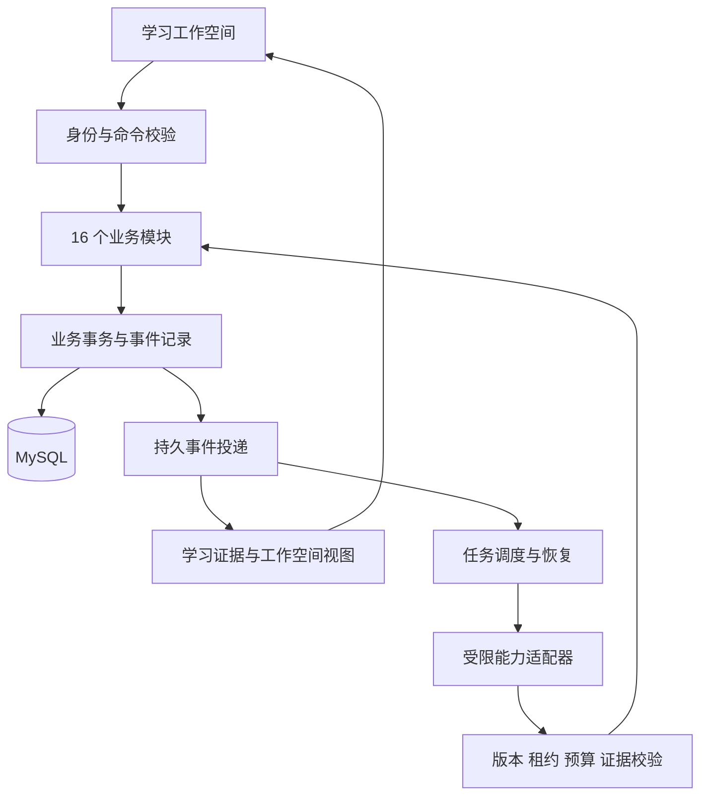
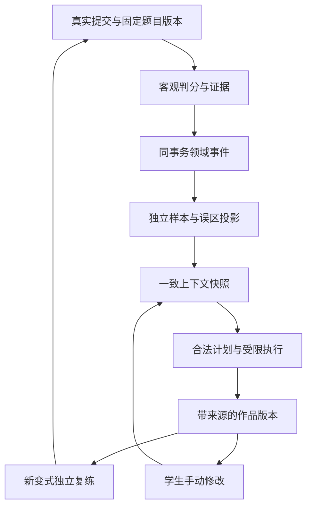

# 从架构基线到可执行的学习状态联动

日期：2026-11-13。本文补充并约束 [总体架构](01-architecture.md)、[专家编排](10-agent-cluster.md)与[作品协议](11-learning-artifacts.md)，保留原有 16 个模块和 Java 17 主线。目标是把已有设计中的版本、权限、事件、租约、预算和学习证据连接为可验证的运行机制。

本文中的“必须”是实现与验收要求，不表示对应功能已经完成。功能是否可调用，以实际 API、[能力矩阵](../agent/capability-matrix.json)、自动化检查及交付记录共同判断。存在接口、表、提示词或 JSON 示例，只能证明设计存在。

## 1 架构选择与本轮实现边界

继续采用一个 Spring Boot 业务控制服务，模块公开端口隔离职责；数据库事务处理核心一致性；持久事件驱动跨模块投影；长任务通过受限执行器工作。编译用户代码和媒体渲染独立隔离。主服务不引入第二套 Python 业务控制面，也不为了专家数量拆成 14 个微服务。

本轮 v0.6 在数据库、身份、工作空间和学习证据基础上接通受限学习任务规划、独立编译服务、私有素材和实际 Office/PDF 导出，并补全闭户与并发失效。通用任意工具自治、生产隔离资源验收和复杂生成媒体仍需要各自的适配器或外部实测；缺失能力不能以模拟成功掩盖。

模块之间的强联动不意味着可以互相写任意表。每个事实由负责该事实的模块产生，其他模块消费事实或通过公开命令请求变更。学生手动编辑、知识撤回、任务停止和外部服务故障都要进入同一状态链。

### 1.1 v0.6 已落地的机制与边界

- 核心数据库写入、语义事件和outbox同事务；消费者效果、receipt和published状态同事务。工作空间事件可按sequence轮询重放，学习前端已用实际请求接续业务；完整SSE恢复协议仍待实现。
- 真实`DurableAgentRuntime`持久DAG、步骤租约、runEpoch、有限尝试、作用域冲突、预算预留、UNKNOWN对账和内部replan；公开入口包括本地证据流程和有限的本地/模型学习任务。未知已派发模型结果保留预留，不能回滚后假装可重试。
- 七个已接通工具按限定工作流执行，核对输入/输出Schema、运行/租约/执行身份和完整输出来源；部分角色由同一持久导师协议承担，不宣称14个通用自主专家全部运行。MODEL 分支顺序调用以保证额度一致，本地分支最多三路。
- 引用失效使运行进入`WAITING_USER`并提升epoch，旧执行结果不能提交；调度不再被最早失效任务堵住。当前公开恢复路径是取消旧任务、创建新快照、发起新任务；自然语言STEER返回503。
- 作品保存校验版本、结构、归属、发布、hash与依赖无环；人工修改、素材撤回及偏好失效在同事务内把衍生版本标为STALE。当前手工/模型/错题源稿仍为DRAFT，不冒充人工事实核验；这不阻止明确标识的真实文件导出。
- 事件选择以各工作空间的流头为依据，死信仅阻塞其自己的后继。运行投影新鲜度与请求成功状态分开呈现。
- `scripts/verify.py`核对实际Java import依赖无环；工作空间通过`ReferenceInvalidator`端口通知衍生作品，错题和检索控制器留在各自模块。

- 导师请求持久保存快照、租约与额度，外部 HTTP 不在 SQL 事务内等待；取消、过期和未知计量不重试成重复付费。回答保存为文档时保留完整来源闭包。
- 读取上下文与执行作品动作统一复核真实内容 hash 和有界祖先图，记忆自然到期也会拒绝使用；不是只依赖撤回事件更新 STALE 标记。
- 文本及 Office/PDF 导出固定源版本与 renderer 版本；领取短事务、锁外有界渲染、fenced提交，真实字节持久化与终态同事务；每次下载重新验证来源、hash 和所有权。
- 人工来源录入、卡/题版本、独立第二人审核、发布清单冻结与历史激活已落地；发布不修改既有工作空间的课程版本。

当前能力与实际测试范围详见 [验收记录](../evidence/runtime-review.md)。未配置模型、完整生成媒体与任意工具自治不会因已有页面或任务表而宣称可用。

### 1.2 短事务锁顺序与成本

学习业务同一用户的写事务采用用户行→工作空间→运行/作品/事件行→投影的锁顺序。内容工作台与启动角色授权先持有单例 content_workbench_lock，再锁当前编辑账号；避免作者/审核人外键与跨账号授予角色形成逆序。两条事务路径不在持有用户锁后反向请求编辑工作台锁。投影同样先取得所属用户，再锁工作空间和outbox；不能只检查显式FOR UPDATE，因为MySQL插入用户外键记录时还会取得父行锁。

统一业务 `TransactionTemplate` 明确使用 `READ_COMMITTED`。归属定位可能先于行锁执行普通读取；如果沿用 MySQL 默认 `REPEATABLE_READ`，等待锁之前建立的读视图会使获锁后的普通查询仍看见旧额度或旧状态。这里由用户/工作空间行锁保护读改写边界，再由 READ_COMMITTED 保证锁后的查询看见前一持有者已提交的事实；不能只设置隔离级别而省略锁。测试用两个独立事务和同步屏障验证此顺序，而不是依赖线程睡眠碰运气。[MySQL 8.4 一致性读语义](https://dev.mysql.com/doc/refman/8.4/en/innodb-consistent-read.html)

这会串行化同一用户跨工作空间的短写事务，换取明确的权限、题目family去重与锁顺序。模型、网络、编译或媒体执行不得占着这些锁等待；只有准入、领取、预留与提交属于短事务。未来高吞吐优化需要真实MySQL并发/死锁/延迟证据，不能删除锁后仅凭单元测试宣称安全。

## 2 十六模块的事实归属与联动

下表是领域职责，不代表所有事件已经有运行中的消费者。事件名用于说明语义；公共接口、实际事件类型和状态枚举需以同步后的契约为准。

| 模块 | 本模块有权决定的事实 | 读取或订阅 | 对下游的约束 |
|---|---|---|---|
| M01 身份权限 | 会话、用户状态、明确偏好和访问资格 | 用户操作与维护配置 | 所有私人资源逐次核验归属；资源 ID 不是授权 |
| M02 知识地图 | 当前发布中的概念、前置关系、知识版本 | M10 发布清单 | 不能把未审核种子当正式知识库；保留历史版本 |
| M03 类型实验 | 被支持规则内的类型关系解释 | M02 概念、M04 编译事实 | 未支持语法返回范围限制；规则解释不冒充完整编译器 |
| M04 编译诊断 | 编译状态、警告、错误码、运行状态 | M03/M05 的受限编译请求 | 绑定源码 hash/JDK/flags；基础设施故障不判学习者错误 |
| M05 练习判分 | 固定题目及规则版本下的提交、得分和提示使用 | M02/M10 内容、M04 证据 | 评分与 outbox 同事务；不信客户端或模型自报正确 |
| M06 学习证据 | 去重后的独立样本、误区与复练状态 | M05 判分事实 | 区分独立作答与提示后作答；作品完成不增加掌握证据 |
| M07 知识加工 | 来源、清洗记录、片段、待审内容 | 获授权材料 | 私人资料不得自动发布；来源和处理过程可追溯 |
| M08 检索证据 | 指定发布及权限范围内的命中列表 | M07/M10 索引、M02 概念 | 返回出处和版本；检索相关度不是事实正确率 |
| M09 教学专家 | 带证据的解释、提示和建议候选 | M02/M04/M06/M08 上下文 | 不改客观成绩；无证据时保留缺口，不创建假引用 |
| M10 内容发布 | 审核结论、不可变发布清单、活动发布指针 | M07 内容、索引构建结果 | 发布失败不切换在线指针；撤回传播至引用作品 |
| M11 评测证据 | 实际测试、评审、贡献和演示记录 | 各模块真实运行记录 | 不把 AI 生成量当个人贡献，不补造未发生的对话 |
| M12 运行安全 | 健康、配置状态、审计、恢复和限流结果 | 所有模块的受限遥测 | 默认不记录密钥、完整私人代码和原始提示词 |
| M13 专家运行 | 合法计划、执行归属、状态、预算和完成条件 | M15 目标、各工具结果 | LLM 提案不能扩大权限；旧 epoch/租约拒绝提交 |
| M14 作品工坊 | 作品源版本、依赖、审核状态、导出状态 | M08 证据、M13 候选 | 源作品与导出分开；学生修改不能被迟到结果覆盖 |
| M15 工作空间 | 目标、语义事件、选区快照、已授权记忆 | M05/M06/M13/M14 事实 | 快照有顺序和版本；删除记忆使后续上下文失效 |
| M16 动态错题 | 引用真实错误的交互作品与复练入口 | M05/M06/M14 | 原题、变式、讲解和独立复练分开；不能伪造新成绩 |

前端通过统一视图把这些结果呈现为一个工作空间。业务上相互关联的数据仍有明确所有者，不能通过一个无边界的全局 JSON 对象绕过模块规则。

## 3 统一引用与服务端解析

沿用 OpenAPI 已有 `ContextRef`，公共字段为 `kind/id/revision/contentHash`。不让客户端通过提交 `ownerId` 声明自己拥有某个资源。会话确定当前用户，路径或已授权对象确定工作空间，数据库和发布清单确定知识版本。

服务端解析后的引用在概念上为 `ResolvedContextRef`。这不是未经契约注册的新公共 API 类型：它描述所有适配器都需要取得的内部校验结果。

| 字段 | 来源 | 校验规则 |
|---|---|---|
| `kind` | 已有 `ContextRef` 枚举 | 根据类型选择专用解析器，拒绝任意表名和文件路径 |
| `id` | 公共引用 | 真实存在且对当前用户可访问；格式合法仍不代表有权读取 |
| `revision` | 公共引用与数据库 | 指向已存在的具体版本；不可静默替换成最新版本 |
| `contentHash` | 服务端计算值与公共引用 | 校验实际内容；不是访问令牌、签名或可信来源证明 |
| `ownerId` | 会话与资源所属关系 | 私人引用必须属于当前访问范围；公共内容走发布权限 |
| `workspaceId` | 路径与资源所属关系 | 私人作品、目标、素材不跨空间混入；共享需独立授权流程 |
| `releaseId` | 工作空间、提交及发布成员关系 | 所有教学证据来自任务固定发布，迁移发布必须显式记录 |

解析顺序：鉴权与路径校验 → 资源存在性 → 归属及发布成员关系 → 版本/hash → 内容大小与类型限制。失败不得返回另一用户资源的正文或内部路径。引用命中缓存后仍需保证权限撤销能生效。

跨层传递资源引用及必要摘要，不传递整份媒体二进制或任意 SQL。模型输出的引用也执行同样解析，不能因为来自“专家”就免检。

## 4 命令与事件的不同作用

命令表达想做什么；事件表达服务端确认发生了什么。`HELP_REQUESTED` 可以发起求助，不能让客户端创建 `StepSucceeded`；`DRAFT_CHANGED` 可以告知当前上下文变化，不能代替作品保存事务。

当前EventJournal实际持久化schemaVersion、eventId、workspaceId、sequence、revision、type、origin、occurredAt和有界data；用户作用域由工作空间和会话确定。跨服务correlationId/causationId是后续追踪扩展目标，当前未承诺完整分布式追踪；新增字段须同步契约、消费者和测试。

| 链路 | 事务内必须一起成立 | 异步处理 | 失败后的可见状态 |
|---|---|---|---|
| 学生提交练习 | 固定题目版本、保存提交、幂等记录 | 编译或判分 | 已接收/判分中；不是已正确 |
| 客观评分完成 | 评分结果、关联证据、outbox 事件 | 学习投影、复练建议 | 得分可见；聚合视图可显示更新中 |
| 保存作品版本 | 校验 baseRevision、创建新版本、推进当前指针、事件 | 更新投影与预览；衍生STALE在原事务同步标记 | 用户看到成功保存的新 revision |
| 新建任务 | 快照、校验后的计划、预算上限、初始事件 | 领取就绪步骤 | 排队；不能提前显示专家已运行 |
| 工具结果提交 | 有效租约/epoch、输出核验、费用结算、步骤事件 | 唤醒依赖节点、更新工作空间 | 仅真实通过的节点成功 |
| 停止任务 | 状态/epoch 变更、停止事件 | 通知执行器并对账外部作业 | 已停止接受旧结果；外部停止进度单独说明 |

outbox 投递允许重复，业务效果必须幂等。消费者以 `(consumer,eventId)` 去重，并把去重凭据与投影更新放进同一事务。仅先写“已处理”再更新视图，会在崩溃时永久丢失更新；仅更新视图再标记，会重复计数。

同一 `Idempotency-Key` 和相同规范化请求返回原资源；同 key 不同请求返回冲突。服务端生成的持久业务 ID 可以作为后续外部调用的幂等基础。随机键若直到失败节点返回时才保存，恢复后可能产生重复费用。[研究依据](14-research-decisions.md#3-持久执行与事件一致性)

## 5 一条贯通的学习与创作主链

示例目标：“我把 `List<Integer>` 当成 `List<Number>` 了，帮我解释，再做能复练的错题卡。”

1. **建立范围**：会话绑定本人工作空间、课程发布和学习目标。读取真实可用能力；没有模型连接时仍允许阅读、客观练习和已有作品编辑。
2. **产生学习证据**：学生先预测或作答。M05 固定题目、规则版本和提示使用情况；需要编译时交给 M04，不能在 API JVM 执行用户代码。
3. **记录真实结果**：评分保存并产生领域事件。M06 消费事件形成误区和复练记录，同一事件重放不增加样本数。
4. **组装上下文**：M15 生成一致快照，包含当前选择、具体提交、诊断和同发布证据。缺失诊断明确标为缺失，不补写推测结果。
5. **规划并执行**：M13 验证专家工具、依赖和预算，领取无冲突步骤。普通问题走短路径；只有作品生成和独立核验确有需要才并行。
6. **形成可编辑作品**：M14/M16 保存文档或错题块源结构，关联原提交、概念和证据。模型候选经校验后才成为可用内容；多媒体能力不可用时返回缺口。
7. **独立复练**：学生在新题或变式上作答，再走 M05/M06 链路。生成漂亮作品不等于学习有效，复练结果才是后续指导的依据。

不变性、PECS、捕获与擦除可以复用同一过程，但各题型的正确性规则必须独立定义。编译错误可能是“预测编译结果”题的正确证据，不应一律判错。

## 6 计划调度执行三层分离

`PlanValidator` 验证任务图合法，不承担身份认证、持久调度或进程隔离。调度器基于数据库状态决定某个执行器是否拥有当前步骤；执行器只能使用注册工具，不能直接修改其他模块内部数据。

每次执行至少固定 runId、planRevision、runEpoch、stepId、attempt、inputRefs/hash、leaseToken、leaseUntil、deadline 和预算预留。完成时再次核验这些值。计划图、工作空间快照和作品 revision 是不同维度，不能共用一个“全局版本”。

| 操作 | 必须先验证 | 提交条件 | 失败处理 |
|---|---|---|---|
| 领取步骤 | 依赖成功、运行未停、能力可用、范围不冲突 | 租约与预留在同事务落盘 | 无资源则继续排队；无能力则明确阻塞 |
| 延长租约 | 当前执行器、epoch、token、未过期 | 原 token 的有界续租 | 被替换的执行器失去提交权 |
| 完成步骤 | 输出结构、真实引用、验收、实际消耗 | 有效 lease/epoch，版本 CAS | 迟到结果保留审计但不改变当前作品 |
| 重规划 | 新目标/快照、合法新图、期望版本 | 提高 planRevision/epoch，撤销受影响执行权 | 旧节点不能完成新计划 |
| 取消 | 当前用户有权控制运行 | 终态与 epoch 先持久化 | 协作取消失败也必须阻止旧结果提交 |
| 恢复 | 持久输入、已知外部 job、当前政策 | 先对账，后决定是否重试 | 外部结果未知时进入待处理状态 |

模型对计划的改写只能提出候选。后台校验仍决定是否接纳。全部必需输出经过真实门禁后才能 `COMPLETED`；部分成果可用时返回 `PARTIAL`，不能因为某个专家说“完成”就推进终态。

## 7 预算与外部副作用

预算分为 token、金额、运行时间和并发占用。金额采用整数微单位，避免浮点累计。预算金额是用户授权的上限，不是供应商真实价格预测。

并行分支先事务预留，满足 `spent + reserved <= limit` 后才开始。完成时按可核查使用量结算、释放未用预留。失败不必然免费；取消也不意味着供应商已退款。没有实际调用就不能产生“模型消耗”记录。

外部工具调用区分“未发出”“已发出等待结果”“成功”“确定失败”“结果未知”。已发出后网络断开不能直接等同失败。先根据 executionKey/providerJobId 查询和对账；供应商不支持幂等或查询时，保留未知状态并说明人工处理需求。

新能力加入注册表前，明确是否纯读、是否并发安全、是否可取消、幂等语义、输出证据与费用估计。省略并发声明默认排他。超时信号只能约束协作式实现，不是硬终止同进程代码的沙箱。[研究依据](14-research-decisions.md#2-三个指定项目的具体迁移)

## 8 记忆证据与内容依赖

聊天窗口、完整历史、任务执行状态、学习事实和用户偏好分开管理。窗口摘要可以删减冗余叙述，不能替代 sourceHash、编译结果、题目版本和已验证引用。偏好可编辑；推断可撤回；任务的实际状态以运行存储为准。

学习证据记录独立/受提示/看答案、题目与规则版本、结果和基础设施状态。数据不足时展示样本数与待复练概念，避免输出没有校准依据的精确掌握概率。FSRS 可作为未来复习日程适配器，但不能直接充当知识迁移能力评分器。

作品依赖区分 FACT、SCRIPT、LAYOUT、ASSET。知识结论变化需要使引用结论的讲义、PPT、旁白和错题解释过期；仅修改配色不应触发事实检索和模型重写。撤回来源使作品显式显示证据失效，不能只清掉缓存后继续标“已核验”。

同一作品多人或多个专家写入时，先解析规范化写范围，再校验租约和 baseRevision。不同块并行也需要明确合并规则；范围字符串不同不自动证明无冲突，例如整页写入与该页单个对象写入仍冲突。

## 9 数据库约束与迁移要求

既有 `V001`/`V002` 是设计基线。已使用的历史迁移不得就地修改；新增运行能力以新版本迁移接入，数据库字典、Java DTO、OpenAPI 和测试同步更新。

| 约束 | 已有设计基础 | 新实现需检查或补充 |
|---|---|---|
| 请求幂等 | idempotency_record | 用户/操作/key 唯一，保存请求 hash 和结果资源，冲突返回一致 |
| 事件顺序 | workspace_event 唯一 `(workspace_id,sequence_no)` | 分配序号和写事件同事务；跨实例不能用本地计数器 |
| 消费幂等 | event_receipt 主键 `(consumer,event_id)` | 去重和投影同事务，失败可重试；不得提前标成功 |
| 私人资源归属 | workspace 与部分复合外键 | goal、artifact、asset、attempt 的组合必须在同一许可范围 |
| 版本唯一 | artifact_revision 与 agent_step 复合约束 | 新版本追加，旧版本不可覆盖；CAS 受影响行数必须检查 |
| 运行预算 | agent_run 非负及总额 CHECK | 事务预留，整数溢出检查；结算幂等，不凭客户端金额计费 |
| 执行归属 | lease_token/lease_until 配对 | 有效 token + epoch +未过期条件更新；过期执行器不可续写 |
| 外部作业 | tool_execution.execution_key 唯一 | 保留外部 job、输入 hash、实际状态；未知结果不得盲重试 |
| 作品关系 | artifact_dependency 同空间复合外键 | 依赖版本存在；拒绝自依赖及环；变更影响闭包有界 |
| 发布归属 | release_chunk/release_exercise | 正式读取绑定成员关系；不凭同 conceptId 跨发布拼接 |

数据库外键保证存在性，不能自动证明“资源属于当前会话用户”“依赖无环”“用户真正学会”或“模型输出事实正确”。这些规则由应用事务和专门验收共同保证。

H2 等本地模式便于快速开发，但不等同 MySQL 验证。时间精度、JSON、约束、唯一性、锁和并发行为必须在声明支持的数据库分别检查。无法运行某种数据库时，应明确留下未验证项。

## 10 降级与用户掌控

| 条件 | 继续可用的能力 | 必须明确告知 |
|---|---|---|
| 未配置模型 | 正式知识阅读、客观练习、真实记录、手动编辑 | 智能生成不可用；不能返回模板假扮模型回答 |
| 编译 worker 不可用 | 不需要编译的题型、已有可信例证、解释阅读 | 编译尚未执行；不把服务故障算错题 |
| 媒体服务失败 | 已生成的源作品、其他完成产物、局部编辑 | 哪个格式未生成，是否已有实际费用 |
| outbox 延迟 | 已提交的主业务记录 | 聚合视图更新中；不能通过再次提交修复延迟 |
| 页面刷新/断网 | 后端已接受的持久任务继续保留 | 重新连接查询任务；网络断开不等于取消 |
| 知识引用失效 | 历史记录与来源说明 | 原依据被撤回，衍生解释需重核 |
| 预算不足 | 已完成作品、人工操作、后续浏览 | 运行暂停或部分完成；不会继续新付费步骤 |

工作空间中的选择、参数和编辑命令保持可逆。Agent 可建议新计划或局部改稿，学生可以保留已有版本、拒绝建议、改变目标、暂停和继续。前端只显示真实状态，现有 209 条参考机制服从业务正确性、可访问性和性能，不作为实现证明。

## 11 可观测性与验证矩阵

每条请求关联 requestId，任务关联 runId/stepId，事件关联 eventId/correlationId，作品关联 revision/hash。日志默认记录 ID、状态、耗时、错误分类和使用量；完整私人材料、密钥和模型输入输出不默认写日志。指标使用低基数字段；用户 ID 不作为无限扩张的指标标签。

| 需要证明的性质 | 最小验收方式 | 不足以证明的检查 |
|---|---|---|
| 真实持久化 | 创建数据后重启并读取原状态 | 单次内存请求成功 |
| 数据归属 | 两个用户对同一资源读写均有正反例 | 仅检测 UUID 格式 |
| 幂等联动 | 重复提交/重复消费后记录和计数不变 | 只有唯一索引静态扫描 |
| 事务一致性 | 注入消费失败，恢复后视图与事实一致 | 把异常吞掉并返回成功 |
| 租约与 epoch | 旧回调、重规划和超时争抢的交叉测试 | 单线程领取一次 |
| 预算守恒 | 并行预留、失败释放、重复结算测试 | 前端余额显示正确 |
| 学习正确性 | 提示/独立/基础设施错误分别验证 | 用作品数量代替学习成效 |
| 作品版本 | 并发改稿冲突，旧引用拒绝或标失效 | 只检查 JSON 可解析 |
| 能力真实性 | adapter、配置、权限、实际输出共同通过 | 工具名字、Schema 或按钮存在 |
| 模型质量 | 相同任务与预算下单 Agent/固定流程/动态编排对照 | 以专家数量、自然语言自评证明智能 |

架构检查、集成测试、数据库测试、模型评测与浏览器验收分别记录。某一层通过不能替代另一层。两位同学应能现场解释一条完整请求的版本、权限、事务、事件、执行与学习反馈路径，并展示一个失败恢复案例。
